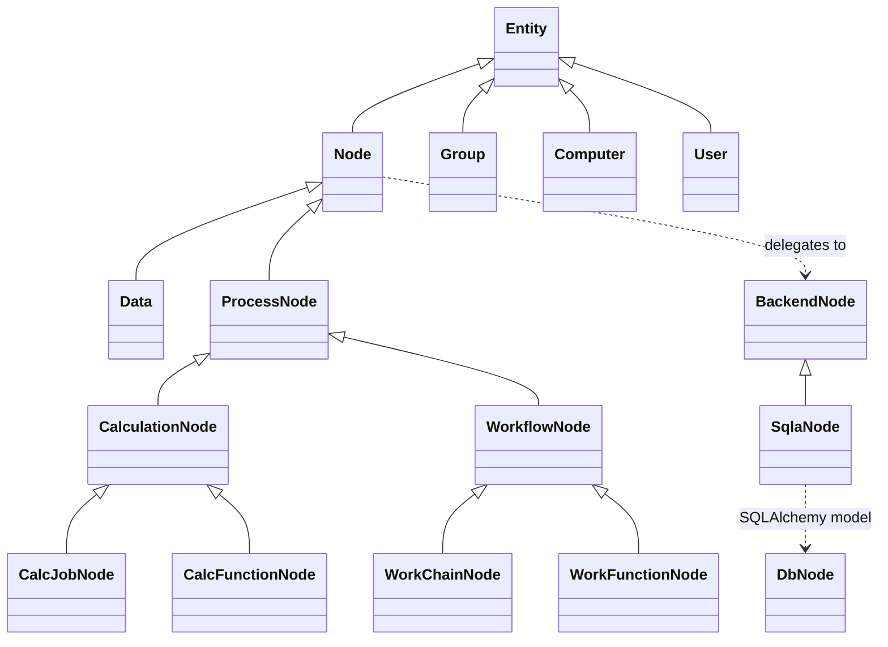
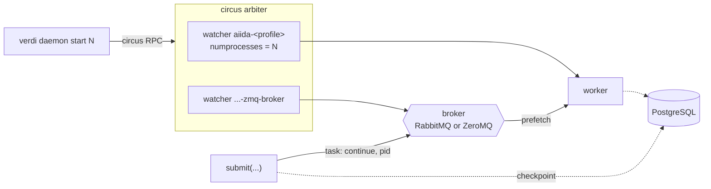
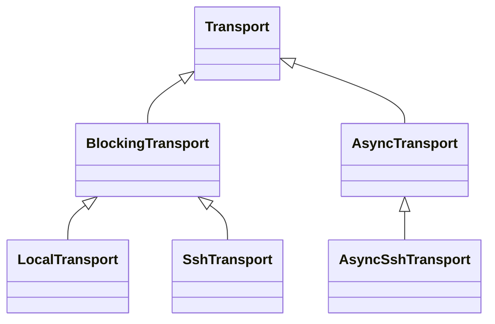
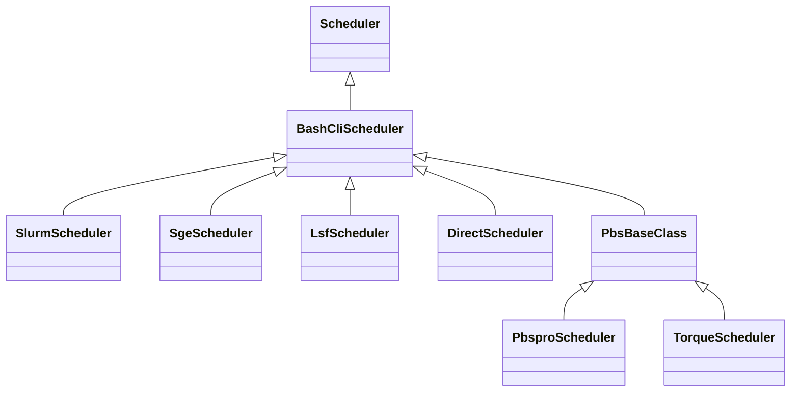

# AiiDA behind the curtain

**Julian Geiger** · PSI

MaterialsCommons WP4 · 7 September 2026

<!--
Q:
-->

---
layout: section
---

# Foundations

<!--
Q:
-->

---

# High-throughput

<div class="flex justify-center pt-2">
  
</div>

<div class="text-sm pt-2 text-center">

2033 Grace Hopper nodes, <b>8132 GPUs and 585,504 CPU cores</b>, 99.96 % utilisation for 18 h

</div>

<div class="refs center">
Quantum ESPRESSO with SIRIUS · Bercx, Minotakis, Reents · 17 to 18 July 2024 ·
<a href="https://marvel-nccr.ch/highlights/AiiDA-hero-run-Alps">marvel-nccr.ch/highlights/AiiDA-hero-run-Alps</a>
</div>

<!--
Q:
-->

---

# Provenance

<div class="grid grid-cols-5 gap-4">
<div class="col-span-3 flex justify-center">
  
</div>
<div class="col-span-2 text-sm pt-6">

- Recorded as the workflow runs
- Nothing declared up front: `while_`, `if_`, dynamic submission
- Calculations create data, workflows return existing data
- Acyclic data provenance, so well-defined ancestor queries
- Immutable once stored, links validated, processes sealed

</div>
</div>

<!--
Q:
-->

---
layout: section
---

# Architecture

<!--
Q:
-->

---

# Source layout

<div class="grid grid-cols-2 gap-6 pt-2">
<div>

<pre class="text-sm" style="line-height: 1.35">src/aiida/
├─ <b>brokers/</b>
├─ calculations/
├─ cmdline/
├─ common/
├─ <b>engine/</b>
├─ manage/
├─ <b>orm/</b>
├─ parsers/
├─ <b>plugins/</b>
├─ <b>repository/</b>
├─ restapi/
├─ <b>schedulers/</b>
├─ sphinxext/
├─ <b>storage/</b>
├─ tools/
├─ <b>transports/</b>
└─ workflows/</pre>

</div>
<div class="flex items-center text-sm opacity-70">

→ &nbsp;**bold**: the rest of this section

</div>
</div>

<!--
Q:
-->

---

# The ORM, object-relational mapping

<div class="grid grid-cols-9 gap-2 pt-2">
<div class="col-span-5">



</div>
<div class="col-span-4 text-sm pt-4">

- Python classes mapped onto database rows, no hand-written SQL
- Attribute access, link traversal and storing, all queries underneath
- Three layers: front-end class, backend entity, SQLAlchemy model
- PostgreSQL to SQLite swaps the bottom two, `Node` unchanged

</div>
</div>

<!--
Q: difference between CalcFunctionNode and CalcJobNode?

A: Both are CalculationNode subclasses, so both may CREATE data. The difference
is where the work runs and what gets recorded.

CalcJobNode: an external executable, run on a Computer through its scheduler.
The engine uploads the inputs, submits, polls, and retrieves. The node stores
that whole lifecycle: remote_workdir, job_id, scheduler_state, retrieve_list,
detailed_job_info, plus a CalcJobState of its own.

CalcFunctionNode: a Python function decorated with @calcfunction, run in the
interpreter that launched it (your shell, or a daemon worker). No scheduler, no
remote folder. Through FunctionCalculationMixin the node records where the code
came from: function_name, function_namespace, the starting line number and the
number of lines, so the source is part of the provenance.

Rule of thumb: CalcJob for anything you would otherwise submit with sbatch,
calcfunction for a small transformation of AiiDA data in Python that still
needs to appear in the graph.

The same split exists one branch over: WorkChainNode is a workflow with steps
and checkpoints, WorkFunctionNode is a @workfunction, a plain Python function
that only returns existing data.
-->

---

# Querying the graph

<div class="grid grid-cols-9 gap-2 pt-2">
<div class="col-span-5 text-xs">

```python
qb = QueryBuilder()
qb.append(
    Group,
    filters={'label': 'mc3d/structures'},
    tag='group',
)
qb.append(
    StructureData,
    with_group='group',
    tag='structure',
    project=['uuid'],
)
qb.append(
    CalcJobNode,
    with_incoming='structure',
    filters={
        'attributes.process_state': 'finished',
        'attributes.exit_status': 0,
    },
    project=['attributes.exit_status'],
)

qb.all()
```

</div>
<div class="col-span-4 text-sm pt-2">

- A path through the graph: one `append` per vertex and its join
- `with_group`, `with_incoming`, `with_outgoing`, `with_ancestors`,
  `with_descendants`
- `filters` on JSONB attributes, `project` on the return
- Ancestors and descendants on `CREATE` and `INPUT_CALC` only: the acyclic half

</div>
</div>

<!--
Q:
-->

---

# Storage

<div class="text-sm pt-1">

- PostgreSQL / SQLite: the graph, plus each node's `attributes` and `extras` as JSONB
- disk-objectstore:
  - raw files, never queried by content
  - content-addressed, keyed by SHA-256
  - packing & deduplication
- Only file-content SHA-256 crossing between both

</div>

<div class="grid grid-cols-2 gap-6 pt-3">
<div class="text-xs">

`repository_metadata`, a column on the node

```json
{"o": {"aiida.in": {"k": "0fc524ff…bfeb1"},
       ".aiida": {"o": {
          "calcinfo.json": {"k": "58d7e318…f782a"}}}}}
```

`o` is children, `k` is the object's SHA-256

</div>
<div class="text-xs">

the container on disk

```text
loose/aa/bbcc…   one file per object
packs/0,1,2      append-only, 4 GiB target
packs.idx        SQLite: hash → pack, offset
```

writes land loose, `verdi storage maintain` packs them

</div>
</div>

<!--
Q:
-->

---

# The execution model

```python
node = submit(SomeWorkChain, **inputs)  # returns immediately
```

<div class="text-sm pt-4">

- One `ProcessNode` row per process
- `submit()`: serialise into `checkpoints`, then a task on the broker
- Worker: take the task, rebuild, step on an event loop
- Checkpoint rewritten at every transition: a killed daemon resumes
- The task carries a pid; the state lives in the database

</div>

<div class="text-sm pt-3">

- A state machine over `CREATED`, `RUNNING`, `WAITING`, `FINISHED`,
  `EXCEPTED`, `KILLED`

</div>

<!--
Q:
-->

---

# The daemon

<div class="grid grid-cols-2 gap-8 pt-4 text-sm">
<div>

**circus**

- OS process supervision only, never AiiDA processes
- Watcher `aiida-<profile>`, `numprocesses=N`, running `verdi daemon worker`
- A second watcher for the ZeroMQ broker service
- `status`, `incr`, `decr`, `stop`: circus RPC over an IPC socket

</div>
<div>

**workers**

- One worker: one OS process, one asyncio loop
- Each AiiDA process a coroutine on that loop
- `verdi daemon start` through circus, `submit()` through the broker

</div>
</div>

<!--
Q:
-->

---

# The broker

```python
# what submit() puts on the queue
{'task': 'continue', 'args': {'pid': pid, 'nowait': False, 'tag': None}}
```

<div class="text-sm pt-3">

- `pid`: the AiiDA `ProcessNode` primary key, as in `verdi process list`
- Worker: load the node, deserialise the checkpoint, continue
- Task queue: durable work, one worker per task
- RPC: one running process by pid, for pause, play, kill
- Broadcast: `state_changed`, subscribed to by waiting workchains
- Prefetch from `worker_process_slots`, ACK deferred to termination
- Unacked on daemon stop, hence redelivered
- RabbitMQ or ZeroMQ behind one `kiwipy.Communicator`

</div>

<div class="refs">
<i>Add ZeroMQ-based message broker plugin</i> &nbsp;<a href="https://github.com/aiidateam/aiida-core/pull/7284">github.com/aiidateam/aiida-core/pull/7284</a>
</div>

<!--
Q:
-->

---

# Daemon and broker, together



<div class="text-sm pt-1">

- Solid: control. Dashed: state.
- `submit(...)` from a script, `verdi shell`, or a parent workchain
- The worker reads the checkpoint back and rewrites it at every transition

</div>

<!--
Q:
-->

---

# Transport and scheduler

<div class="grid grid-cols-2 gap-4 pt-1">
<div>



</div>
<div>



</div>
</div>

<div class="text-sm pt-1">

- Two plugin interfaces: file transfer and remote commands, job submission
- `aiida-firecrest`, an out-of-tree transport for the FirecREST API
- `TransportQueue`: one shared transport per computer and user
- `JobsList`: one `squeue` per computer per polling interval, fanned out
- Exponential backoff on transport tasks, ending in a paused process

</div>

<div class="refs">
<i>Transport: AsyncTransport plugin</i> &nbsp;<a href="https://github.com/aiidateam/aiida-core/pull/6626">github.com/aiidateam/aiida-core/pull/6626</a>
</div>

<!--
Q:
-->

---
layout: section
---

# Making it simpler

<!--
Q:
-->

---

# No services required

```bash
pip install aiida-core
verdi presto
```

<div class="text-sm pt-4">

- RabbitMQ the only broker until v2.9, now also ZeroMQ 
- Started and supervised by the daemon
- IPC sockets, local only
- Remote workers still on RabbitMQ

</div>

<div class="refs">
<i>Released in v2.9.0 · Add ZeroMQ-based message broker plugin</i> &nbsp;<a href="https://github.com/aiidateam/aiida-core/pull/7284">github.com/aiidateam/aiida-core/pull/7284</a>
</div>

<!--
Q:
-->

---

# The install path

<div class="grid grid-cols-9 gap-3 pt-1">
<div class="col-span-5 text-xs">

```bash
# first install PostgreSQL and RabbitMQ, create the
# database and its user, then describe what you built
verdi setup \
    --database-engine \
    --database-backend \
    --database-hostname \
    --database-port \
    --database-name \
    --database-username \
    --database-password \
    --broker-protocol \
    --broker-username \
    --broker-password \
    --broker-host \
    --broker-port \
    --broker-virtual-host \
    --repository-uri
```

</div>
<div class="col-span-4 text-sm pt-4">

```bash
verdi quicksetup
# created the database for you,
# still needed both services running
```

```bash
verdi presto
# v2.6: no required options
# v2.9: no services either
```

<div class="pt-3">

- Full control retained: `verdi profile setup core.psql_dos`
- `verdi quicksetup` deprecated

</div>

</div>
</div>

<!--
Q:
-->

---
layout: section
---

# Current efforts

<!--
Q:
-->

---

# Workflow construction

<div class="grid grid-cols-2 gap-6 text-xs">
<div>

WorkChain

```python
class MultiplyAddWorkChain(WorkChain):
    @classmethod
    def define(cls, spec):
        super().define(spec)
        spec.input('x', valid_type=Int)
        spec.input('y', valid_type=Int)
        spec.input('z', valid_type=Int)
        spec.input('code', valid_type=AbstractCode)
        spec.outline(
            cls.multiply,
            cls.add,
            cls.validate_result,
            cls.result,
        )
        spec.output('result', valid_type=Int)
```

plus four methods passing data through `self.ctx`

</div>
<div>

WorkGraph 0.9.0

```python
@task
def add(x, y):
    return x + y


@task
def multiply(x, y):
    return x * y


@task.graph
def AddMultiply(x, y, z):
    the_sum = add(x=x, y=y).result
    return multiply(x=the_sum, y=z).result


wg = AddMultiply.build(x=2, y=3, z=4)
wg.run()
```

</div>
</div>

<!--
Q:
-->

---

# Consolidating into core

<div class="grid grid-cols-2 gap-6 pt-3 text-sm">
<div>

**What is moving**

- All of it aimed at v3, the next major release
- `plumpy`, the process state machine
- The workflow construction ecosystem:
  - `aiida-shell`: shell command execution without dedicated plugins
  - `aiida-pythonjob`: plain Python functions on remote computers
  - `node-graph`: graph-based workflow API
  - `aiida-workgraph`: the AiiDA execution layer of `node-graph`
- Mostly deletions on the aiida-workgraph side
- Nothing merged yet, no AEP accepted, WorkGraph slower than WorkChain

</div>
<div>

**Why**

- A minor change needs one release
- A public API that can be stated at all
- Less inheritance, more composition
- Before: private by convention, unenforced, everything bubbled up by
  `__all__` and star imports
- Now: `_` prefix on internals, a frozen `__all__`, a snapshot test

</div>
</div>

<div class="refs">
<i>Integrate plumpy into aiida-core</i> &nbsp;<a href="https://github.com/aiidateam/aiida-core/pull/7587">github.com/aiidateam/aiida-core/pull/7587</a><br>
<i>Lock the public/private API boundary for v3</i> &nbsp;<a href="https://github.com/aiidateam/aiida-core/pull/7411">github.com/aiidateam/aiida-core/pull/7411</a>
</div>

<!--
Q:
-->

---

# Agents

<div class="grid grid-cols-9 gap-3 pt-2">
<div class="col-span-5 text-sm">

**`aiida-agents`**, GSoC 2026

```text
src/aiida_agents/
├─ agents/    analysis · codegen · execution · planner
├─ mcp/       MCP server, read-only tools
├─ rag/       chunking, embedding, retrieval, citations
├─ sandbox/   profile copy, code runner, static guard
└─ tools/     the typed tool functions
```

- Explore, inspect, diagnose, look up the docs, set up, run
- Typed tool calls against your own provenance graph
- Writes behind an explicit approval gate
- Local models through Ollama: nothing leaves the machine

</div>
<div class="col-span-4 text-sm">

**How we develop**

- `AI_POLICY.md`: a responsible human author per PR
- A PR regenerated from review comments: grounds to close
- `AGENTS.md` and 10 Claude Code skills in-repo
- CodeRabbit on every non-draft PR

</div>
</div>

<div class="refs">
<i>Add AI_POLICY.md</i> &nbsp;<a href="https://github.com/aiidateam/aiida-core/pull/7229">github.com/aiidateam/aiida-core/pull/7229</a><br>
<i>Add AGENTS.md and Claude Code skills</i> &nbsp;<a href="https://github.com/aiidateam/aiida-core/pull/7265">github.com/aiidateam/aiida-core/pull/7265</a>
</div>

<!--
Q:
-->

---
layout: section
---

# Ecosystem

<!--
Q:
-->

---

# Plugins and common workflows

<div class="grid grid-cols-2 gap-6 pt-2">

<div class="flex flex-col">
  <div class="flex items-center justify-center" style="height: 300px">
    
  </div>
  <div class="text-sm pt-2">108 plugin packages, 72 wrapping a simulation code</div>
</div>

<div class="flex flex-col">
  <div class="flex items-center justify-center" style="height: 300px">
    
  </div>
  <div class="text-sm pt-2"><code>aiida-common-workflows</code>: one code-agnostic interface over 13 engines</div>
</div>

</div>

<div class="refs">retrieved 2026-09-04</div>

<!--
Q:
-->

---

# Publishing and browsing

<div class="grid grid-cols-2 gap-6 pt-2">

<div class="flex flex-col">
  <div class="flex items-center justify-center" style="height: 320px">
    
  </div>
  <div class="text-sm pt-2">Materials Cloud Archive: 1238 records, 2.55 TB, each with a DOI</div>
</div>

<div class="flex flex-col">
  <div class="flex items-center justify-center" style="height: 320px">
    
  </div>
  <div class="text-sm pt-2">Published provenance, browsable node by node</div>
</div>

</div>

<div class="refs">retrieved 2026-09-04</div>

<!--
Q:
-->

---

# AiiDAlab

<div class="flex justify-center pt-1">
  
</div>

<div class="grid grid-cols-2 gap-8 pt-3 text-sm">
<div>

- Jupyter-based, with an app store; 16 apps registered
- Each panel above a plugin, with its own workchains

</div>
<div>

- Public demo, institutional JupyterHubs, or local Docker
- The same engine underneath, without `verdi`

</div>
</div>

<!--
Q:
-->

---

# Thanks

<div class="pt-8 text-sm opacity-70">

Julian Geiger · julian.geiger@psi.ch

</div>

<!--
Q:
-->

---
layout: section
---

# Backup

<!--
Q:
-->

---

# Process states

<div class="grid grid-cols-9 gap-2 pt-2">
<div class="col-span-4 text-sm">

```python
class Created(State):
    LABEL = ProcessState.CREATED
    ALLOWED = {
        ProcessState.RUNNING,
        ProcessState.KILLED,
        ProcessState.EXCEPTED,
    }
```

</div>
<div class="col-span-5 text-sm">

- Six states: `CREATED`, `RUNNING`, `WAITING`, `FINISHED`, `EXCEPTED`, `KILLED`
- Legal transitions declared per state class
- A decade in `plumpy`, now merged into core in September

</div>
</div>

<div class="refs">
<i>Integrate plumpy into aiida-core</i> &nbsp;<a href="https://github.com/aiidateam/aiida-core/pull/7587">github.com/aiidateam/aiida-core/pull/7587</a>
</div>

<!--
Q:
-->

---

# The state machine

```python
future = self.submit(RelaxWorkChain, structure=structure)
self.to_context(relaxations=append_(future))
```

<div class="text-sm pt-4">

- `Waiting`: no thread held, no connection held
- Broker broadcast on child termination as the wake-up
- `CalcJob`, a second state machine: upload, submit, update, stash, retrieve
- Exponential-backoff retry per step

</div>

<!--
Q:
-->

---

# The checkpoint, in full

<div class="text-xs">

```yaml
!aiida:bundle
'!!meta':
  class_name: aiida.workflows.arithmetic.multiply_add:MultiplyAddWorkChain
  types: {_event_helper: S, _future: S}
  user: {object_loader: aiida.common.loaders:DefaultObjectLoader}
CONTEXT: !aiida_attributedict {}
INPUTS_RAW: '!aiida:attributes_frozendict
  code: !aiida_node ''005332ea-1013-4c48-817e-1cc05459dc63''
  x: !aiida_node ''4ea9b679-d8c2-4b77-a653-1115a98083ef''
  y: !aiida_node ''c5f47a83-ee64-4033-a054-83e0d920269f''
  z: !aiida_node ''2a66bc2e-408c-4d8a-90af-2d92ebabf856'''
_awaitables: []
_state:
  '!!meta': {class_name: aiida.engine.processes.states:Created}
  run_fn: run
  in_state: true
_pid: 5
calc_id: 5
```

</div>

<div class="text-sm pt-2">

- A `MultiplyAddWorkChain` before its first step, 1534 characters
- Nodes by UUID reference, so a large input costs nothing here
- `_state` names the state class; `CONTEXT` fills as `to_context` results arrive
- Stored as the `checkpoints` attribute on the process node

</div>

<!--
Q:
-->

---

# Where this touches WP4

<div class="text-sm pt-4">

| | |
| --- | --- |
| T4.3, we lead | PWD across AiiDA, pyiron, PerQueue, SimStack |
| T4.1 | reusable parsers across engines: ours are plugins, registered by entry point |
| T4.4 | FAIR software: `Code`, `Computer`, containers |
| T4.5 | semantic annotation; we have typed ports, no semantics |

</div>

<div class="text-sm pt-6">

- Open: cross-site data transfer
- Open: FirecREST beyond CSCS as project effort

</div>

<!--
Q:
-->

---

# Python Workflow Definition

<div class="grid grid-cols-2 gap-4 text-xs">
<div>

```json
{
  "version": "0.1.0",
  "nodes": [
    {"id": 0, "type": "function", "value": "workflow.get_prod_and_div"},
    {"id": 1, "type": "function", "value": "workflow.get_sum"},
    {"id": 2, "type": "function", "value": "workflow.get_square"},
    {"id": 3, "type": "input", "value": 1, "name": "x"},
    {"id": 4, "type": "input", "value": 2, "name": "y"},
    {"id": 5, "type": "output", "name": "result"}
  ],
  "edges": [
    {"target": 0, "targetPort": "x", "source": 3, "sourcePort": null},
    {"target": 0, "targetPort": "y", "source": 4, "sourcePort": null},
    {"target": 1, "targetPort": "x", "source": 0, "sourcePort": "prod"},
    {"target": 1, "targetPort": "y", "source": 0, "sourcePort": "div"},
    {"target": 2, "targetPort": "x", "source": 1, "sourcePort": null},
    {"target": 5, "targetPort": null, "source": 2, "sourcePort": null}
  ]
}
```

</div>
<div class="text-sm">

- Three files: `environment.yml`, `workflow.py`, `workflow.json`
- Nomenclature from the Eclipse Layout Kernel
- `targetPort`: keyword argument on the receiver
- `sourcePort`: key of a multi-valued return
- Functions referenced by dotted import path, no version or hash
- Built in a WfMS and exported, never written by hand

</div>
</div>

<div class="refs">
Janssen, George, Geiger et al., <i>Digital Discovery</i> <b>4</b>, 3149 (2025) ·
<a href="https://doi.org/10.1039/D5DD00231A">doi.org/10.1039/D5DD00231A</a>
</div>

<!--
Q:
-->

---

# Engine support, and the gaps

<div class="text-sm">

| Engine | Import | Export |
| --- | --- | --- |
| aiida-workgraph, jobflow, pyiron_base, pyiron_workflow | yes | yes |
| executorlib, pure Python | yes, executes immediately | no |
| CWL | no | one-way |
| PerQueue | prototype in a separate repo | |
| SimStack, Airflow, ewoks | nothing in the repo | |

</div>

<div class="text-sm pt-4">

- DAGs only: no loops, no conditionals, no growth at runtime
- No compute resources, no results; the template travels alone
- A `while` encoding designed at MADICES 2025, still unlanded

</div>

<!--
Q:
-->

---

# Transport and job polling

<div class="text-sm">

- `TransportQueue`: one transport per computer and user, shared
- Respects `Transport.get_safe_open_interval()`
- `JobsList`: one `squeue` per computer per polling interval
- 100 calculations on one machine, 1 SSH connection
- Workers are asynchronous; the cap is `daemon.worker_process_slots`

</div>

<!--
Q:
-->

---

# Computers, transports, schedulers

```python
computer = Computer(
    label='daint',
    transport_type='core.ssh_async',  # core.ssh, core.local, firecrest
    scheduler_type='core.slurm',  # pbspro, sge, lsf, torque, direct
)
```

<div class="text-sm pt-4">

- AiiDA runs on your machine, nothing is installed on the cluster
- One profile drives several clusters into one graph
- `Transport`: 63 abstract methods, 31 blocking and 32 async
- `Scheduler`: 4 abstract methods
- Also `Parser`, `StorageBackend`, `AbstractCode`, all entry points

</div>

<!--
Q:
-->

---

# Why an object store

<div class="grid grid-cols-2 gap-8 pt-4 text-sm">
<div>

MC3D provenance archive:

| | |
| --- | --- |
| nodes | 535,005 |
| links | 1,257,350 |
| distinct objects | 837,443 |
| median object | 512 B |
| under 1 KiB | 59.6 % |

</div>
<div>

- Most objects are smaller than a 4 KiB block
- Loose layout wastes ~2.2x in disk blocks
- Inode limits have been hit in practice

<div class="pt-4 text-xs opacity-60">

"a common filesystem has a maximum number of inodes … we already have experience
of AiiDA repositories that hit this limit" (<a href="https://github.com/aiidateam/AEP/blob/master/006_efficient_object_store_for_repository/readme.md">github.com/aiidateam/AEP/blob/master/006_efficient_object_store_for_repository/readme.md</a>)

</div>

</div>
</div>

<!--
Q:
-->

---

# The concurrency contract

<div class="text-sm pt-4">

| | |
| --- | --- |
| readers | any number, any object |
| writers | any number, loose objects only |
| packing | one single process |
| delete, repack, vacuum | exclusive access |

</div>

<div class="text-sm pt-6">

- No guards in the library; AiiDA holds the profile lock
- Atomic rename is where NFS and Lustre stop guaranteeing
- Loose objects hurt on parallel filesystems with inode quotas

</div>

<!--
Q:
-->

---

# Transports: recent work

<div class="text-sm pt-4">

- `core.ssh_async`, file transfers over dedicated data transfer nodes
- Stashing: explicit workflow step, tracked in the provenance graph
- `aiida-firecrest` as a `Transport` implementation
- FirecREST deployed on our 10-node Slurm cluster at PSI
- Workchain from a workstation ran to completion through it

</div>

<div class="refs">
<i>Transport: AsyncTransport plugin</i> &nbsp;<a href="https://github.com/aiidateam/aiida-core/pull/6626">github.com/aiidateam/aiida-core/pull/6626</a>
</div>

<!--
Q:
-->

---

# Common misconceptions

<div class="text-sm pt-4">

- "AiiDA is a DAG scheduler": the DAG records what already ran
- The daemon orchestrates, the cluster scheduler runs the compute
- Workers are asynchronous, one handles many jobs
- The database holds engine state as well as provenance; losing it loses
  running workflows

</div>

<!--
Q:
-->

---

# aiida-shell and aiida-pythonjob

```python
from aiida_shell import launch_shell_job

results, node = launch_shell_job('date')
print(results['stdout'].get_content())
```

```python
@task.pythonjob
def add(x: int, y: int) -> int:
    return x + y


@task.graph
def RemoteAdd(x: int, y: int, computer: str) -> int:
    return add(x=x, y=y, computer=computer).result


wg = RemoteAdd.build(x=1, y=2, computer='localhost')
```

<!--
Q:
-->

---

# Type coverage

<div class="grid grid-cols-2 gap-8 pt-6 text-sm">
<div>

| | |
| --- | --- |
| Jun 2020 | 2 / 538 files |
| Dec 2022 | 412 / 575 |
| today | 558 / 652 (85.6 %) |

</div>
<div>

- `mypy strict = true`, five flags still disabled
- 503 errors left in 74 files
- `storage` and `restapi` are 55 % of them

</div>
</div>

<div class="refs">
<i>v3: Type-check all of src/aiida</i> &nbsp;<a href="https://github.com/aiidateam/aiida-core/issues/7403">github.com/aiidateam/aiida-core/issues/7403</a>
</div>

<!--
Q:
-->

---

# aiida-agents

```text
src/aiida_agents/
├─ agents/     analysis · codegen · execution · planner
├─ mcp/        MCP server, read-only tool registrations
├─ rag/        chunking, embedding, retrieval, citations
├─ sandbox/    profile copying, code runner, static guard
└─ tools/      the typed tool functions
```

<div class="text-sm pt-4">

- Google Summer of Code 2026
- Answers against your own provenance graph
- Every answer comes from a typed tool call
- Writes gated behind an explicit approval

</div>

<!--
Q:
-->

---

# The format

<div class="grid grid-cols-2 gap-4 text-xs">
<div>

`workflow.json`

```json
{
  "version": "0.1.0",
  "nodes": [
    {"id": 0, "type": "function", "value": "workflow.get_prod_and_div"},
    {"id": 1, "type": "function", "value": "workflow.get_sum"},
    {"id": 2, "type": "function", "value": "workflow.get_square"},
    {"id": 3, "type": "input", "value": 1, "name": "x"},
    {"id": 4, "type": "input", "value": 2, "name": "y"},
    {"id": 5, "type": "output", "name": "result"}
  ],
  "edges": [
    {"target": 0, "targetPort": "x", "source": 3, "sourcePort": null},
    {"target": 0, "targetPort": "y", "source": 4, "sourcePort": null},
    {"target": 1, "targetPort": "x", "source": 0, "sourcePort": "prod"},
    {"target": 1, "targetPort": "y", "source": 0, "sourcePort": "div"},
    {"target": 2, "targetPort": "x", "source": 1, "sourcePort": null},
    {"target": 5, "targetPort": null, "source": 2, "sourcePort": null}
  ]
}
```

</div>
<div>

`workflow.py`

```python
def get_prod_and_div(x, y):
    return {'prod': x * y, 'div': x / y}


def get_sum(x, y):
    return x + y


def get_square(x):
    return x**2
```

<div class="pt-4">

- `targetPort`: keyword argument on the receiver
- `sourcePort`: key of a multi-valued return
- Functions referenced by dotted import path
- No version, no hash, no signature

</div>

</div>
</div>

<!--
Q:
-->

---

# Export and import

```python
from python_workflow_definition.aiida import write_workflow_json
from aiida_workgraph import WorkGraph, task

wg = WorkGraph('arithmetic')
prod_div = wg.add_task(
    task(outputs=['prod', 'div'])(get_prod_and_div),
    x=orm.Float(1),
    y=orm.Float(2),
)
total = wg.add_task(
    get_sum, x=prod_div.outputs.prod, y=prod_div.outputs.div
)
write_workflow_json(wg=wg, file_name='workflow.json')
```

```python
from python_workflow_definition.jobflow import load_workflow_json

flow = run_locally(load_workflow_json(file_name='workflow.json'))
```

<!--
Q:
-->

---

# References

<div class="text-xs pt-4">

- Huber et al., *AiiDA 1.0*, Sci. Data **7**, 300 (2020)
- Uhrin et al., *Workflows in AiiDA*, Comput. Mater. Sci. **187**, 110086 (2021)
- Janssen, George, Geiger et al., *A Python workflow definition*, Digital Discovery **4**, 3149 (2025)
- Talirz et al., *Materials Cloud*, Sci. Data **7**, 299 (2020)
- Yakutovich et al., *AiiDAlab*, Comput. Mater. Sci. **188**, 110165 (2021)
- Huber et al., *Common workflows*, npj Comput. Mater. **7**, 136 (2021)
- Bosoni et al., *Verifying DFT precision*, Nat. Rev. Phys. **6**, 45 (2023)
- Storage design: AEP 006, no paper

</div>

<!--
Q:
-->
