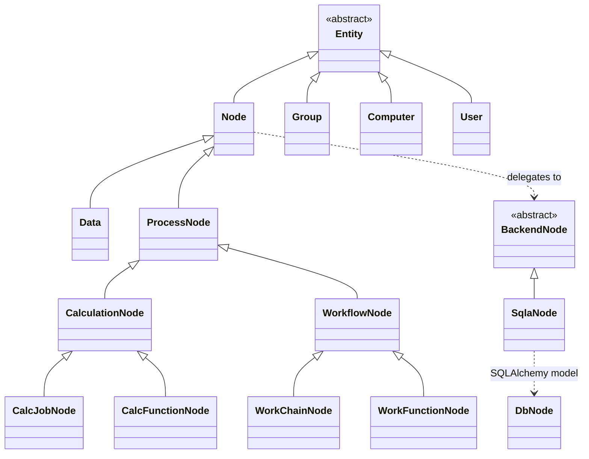
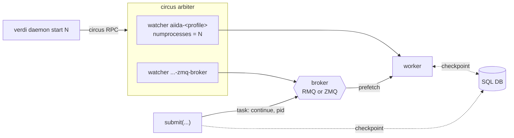
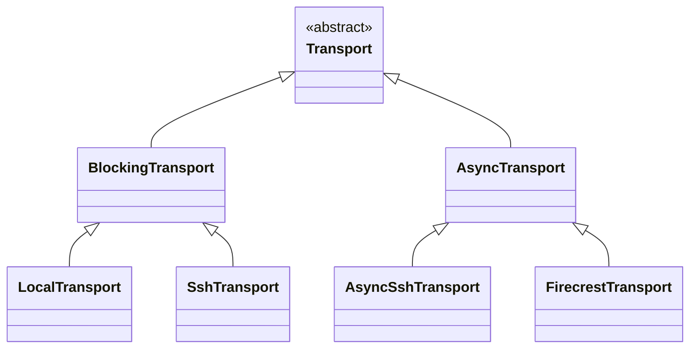
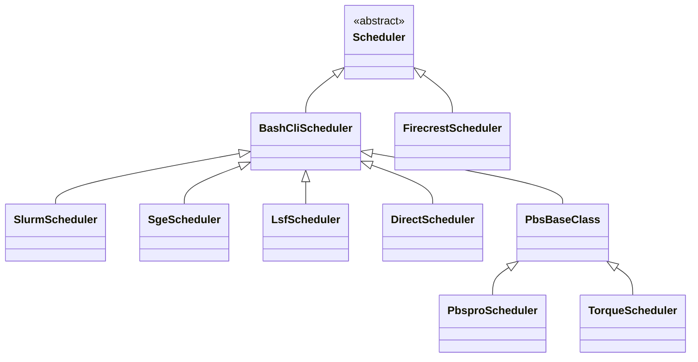

<div class="flex items-center gap-10" style="height: 100%">
<div class="title-hero" style="flex: 1 1 auto">

# AiiDA behind the curtain

**Julian Geiger** · PSI

MaterialsCommons WP4 · 7 September 2026

</div>
<div class="flex flex-col items-center gap-10" style="flex: 0 0 310px">
  
  
</div>
</div>

<!--
Q:
-->

---

# Plenty of workflow managers

<div class="grid grid-cols-2 gap-16 pt-10 text-center">
<div>
  <div class="text-base font-mono">pditommaso/awesome-pipeline</div>
  <div class="text-lg opacity-40 pt-1">&darr;</div>
  <div class="text-3xl pt-1">237</div>
</div>
<div>
  <div class="text-base font-mono">meirwah/awesome-workflow-engines</div>
  <div class="text-lg opacity-40 pt-1">&darr;</div>
  <div class="text-3xl pt-1">115</div>
</div>
</div>

<div class="text-center pt-14 italic opacity-80">

The difference lies in their focus and in architecture.

</div>

<div class="refs">
<a href="https://github.com/pditommaso/awesome-pipeline">github.com/pditommaso/awesome-pipeline</a><br>
<a href="https://github.com/meirwah/awesome-workflow-engines">github.com/meirwah/awesome-workflow-engines</a>
</div>

<!--
Q:
-->

---
layout: section
---

# Foundations

<!--
Q:
-->

---

# High-throughput

<div class="flex justify-center pt-2">
  
</div>

<div class="text-sm pt-2 text-center">

2033 Grace Hopper nodes, <b>8132 GPUs and 585,504 CPU cores</b>, 99.96 % utilisation for 18 h

</div>

<div class="text-sm pt-3">

- Daemon workers: independent Python processes, submitting and polling in parallel
- Throughput scales with their number, to about one per CPU core

</div>

<div class="refs center">
Quantum ESPRESSO with SIRIUS · Bercx, Minotakis, Reents · 17 to 18 July 2024 ·
<a href="https://marvel-nccr.ch/highlights/AiiDA-hero-run-Alps">marvel-nccr.ch/highlights/AiiDA-hero-run-Alps</a>
</div>

<!--
Q:
-->

---

# Provenance

<div class="grid grid-cols-5 gap-4">
<div class="col-span-3 flex justify-center">
  
</div>
<div class="col-span-2 text-sm pt-6">

- Recorded as the workflow runs: `while_`, `if_`, dynamic submission
- Immutable once stored, links validated, processes sealed
- Results can be traced back at any future point in time

</div>
</div>

<!--
Q: 
- Calculations create data, workflows return existing data
- Acyclic data provenance, so well-defined ancestor queries

-->

---
layout: section
---

# Architecture

<!--
Q:
-->

---

# Source layout

<div class="grid grid-cols-2 gap-6 pt-2">
<div>

<pre class="text-sm" style="line-height: 1.35">src/aiida/
├─ <b>brokers/</b>
├─ calculations/
├─ <b>cmdline/</b>
├─ common/
├─ <b>engine/</b>
├─ manage/
├─ <b>orm/</b>
├─ parsers/
├─ plugins/
├─ <b>repository/</b>
├─ restapi/
├─ <b>schedulers/</b>
├─ sphinxext/
├─ <b>storage/</b>
├─ tools/
├─ <b>transports/</b>
└─ workflows/</pre>

</div>
<div class="flex flex-col justify-center gap-4 text-sm opacity-70">

→ &nbsp;**bold**: the rest of this section

</div>
</div>

<!--
Q:
-->

---

# Storage

<div class="text-sm pt-1">

- PostgreSQL / SQLite: the graph, plus each node's `attributes` and `extras` as JSONB
- the file repository, `disk-objectstore`:
  - content-addressed, keyed by SHA-256
  - raw files, never queried by content
  - packing & deduplication
- Only file-content SHA-256 crossing between both

</div>

<div class="grid grid-cols-2 gap-6 pt-3">
<div class="text-xs">

`repository_metadata`, a column on the `Node`

```json
{"o": {"aiida.in": {"k": "0fc524ff…bfeb1"},
       ".aiida": {"o": {
          "calcinfo.json": {"k": "58d7e318…f782a"}}}}}
```

`o` for `objects`, the entries in a directory; `k` for `key`, the SHA-256

</div>
<div class="text-xs">

the file-repository container on disk

```text
loose/aa/bbcc…   one file per object
packs/0,1,2      append-only, 4 GiB target
packs.idx        SQLite: hash → pack, offset
```

each new object is written as its own file, then `verdi storage maintain`
concatenates them into packs

</div>
</div>

<div class="refs">
<a href="https://github.com/aiidateam/disk-objectstore">github.com/aiidateam/disk-objectstore</a>
</div>

<!--
Q: why does SqliteDosStorage inherit from PsqlDosBackend?

A: Reuse, not is-a. Sqlite overrides __init__, get_container,
initialise_database, _alembic_config, validate_storage, migrate, the paths and
initialise; when the child overrides most of the parent it should be a sibling
under a shared SQLAlchemy base instead.
Recognised: aiida-core#7510, "v3: Storage architecture redesign", open.
Concrete case for the "less inheritance, more composition" bullet later.
-->

---

# The ORM, object-relational mapping

<div class="grid grid-cols-9 gap-2 pt-2">
<div class="col-span-6">



</div>
<div class="col-span-3 text-sm pt-4">

- Python classes over database rows
- `Entity`: pk, uuid, `store()`
- `Node`: links, attributes, extras, file repository
- `Data` subclasses: primitives, files, folders, structures, arrays

</div>
</div>

<!--
Q: difference between CalcFunctionNode and CalcJobNode?

A: Both CalculationNode subclasses, so both CREATE data.
CalcJobNode: external executable via a scheduler; stores remote_workdir,
job_id, scheduler_state, retrieve_list.
CalcFunctionNode: @calcfunction in the local interpreter; stores the function
name and source location instead.
Same split one branch over: WorkChainNode vs WorkFunctionNode.

Q: difference between Entity and Node?

A: Entity is the base for everything stored in a profile: pk, uuid, store(),
is_stored, a collection, and a backend entity behind it. Node, Group, Computer,
User, Comment, Log and AuthInfo are all Entities.
Node is the one that sits in the provenance graph, so it adds what the others
have no use for: links, attributes and extras, a file repository, caching. All
reached through node.base (base.links, base.attributes, base.repository).

Q: responsibilities of BackendNode, SqlaNode, and DbNode, each?

A: BackendNode: the storage-agnostic contract, 30 abstract methods, no SQL.
SqlaNode: the SQLAlchemy implementation of it. Wraps one DbNode, holds the
session. Shared by psql_dos and sqlite_dos, since SqliteDosStorage subclasses
PsqlDosBackend.
DbNode: the SQLAlchemy declarative model, table db_dbnode. Columns only.

Naming is historical: Db* and the db_db prefix are Django-era, kept through the
move to SQLAlchemy. Sqla* names the wrapper, not the model.

Q: Three layers: ORM class, storage contract, SQLAlchemy model


-->

---

# Querying the graph

<div class="grid grid-cols-9 gap-2 pt-2">
<div class="col-span-5 text-xs">

```python
qb = QueryBuilder()
qb.append(
    Group,
    filters=Group.fields.label == 'mc3d/structures',
    tag='group',
)
qb.append(
    StructureData,
    with_group='group',
    tag='structure',
    project=[StructureData.fields.uuid],
)
qb.append(
    CalcJobNode,
    with_incoming='structure',
    filters=(
        (CalcJobNode.fields.process_state == 'finished')
        & (CalcJobNode.fields.exit_status == 0)
    ),
    project=['*'],
)

qb.all()
```

</div>
<div class="col-span-4 text-sm pt-2">

- A path through the graph: one `append` per vertex and its join
- `with_group`, `with_incoming`, `with_outgoing`, `with_ancestors`, `with_descendants`
- `Class.fields.*` for filters and projections, typed and autocompleting
- `project='*'` returns the nodes themselves

</div>
</div>

<!--
Q: Write the query in prose here

A: "Take the group labelled mc3d/structures. For every StructureData in it,
find the CalcJobNodes that consumed it as an input and finished with exit
status 0. Return the structure's UUID alongside that exit status."

Three vertices, two joins: group to structure by membership, structure to
calculation by an input link.

Q: Ancestors and descendants on `CREATE` and `INPUT_CALC` only: the acyclic half

-->

---

# Submitting a workflow

```python
from aiida.engine import submit

node = submit(SomeWorkChain, **inputs)  # returns immediately
```

<div class="text-sm pt-4">

- One `ProcessNode` row per process
- `submit()` serialises inputs, context and state into `checkpoints`
- Daemon worker: background Python process with an event loop
- Rebuilds the process from its checkpoint, steps it to the next state
- Checkpoint rewritten at every transition: a killed daemon resumes

</div>

<div class="text-sm pt-3">

- Every `Process` is a state machine: `CREATED`, `RUNNING`, `WAITING`, `FINISHED`, `EXCEPTED`, `KILLED`

</div>

<!--
Q:
-->

---

# The daemon and the broker

<div class="text-sm pt-2 compact">

**Daemon**

- `verdi daemon start N`: N workers, supervised by `circus`
- One worker: one OS process, one asyncio loop
- Each AiiDA process: a coroutine on that loop
- `verdi daemon status|incr|decr|stop`: circus RPC over an IPC socket

**Broker**

- The message layer between `submit()`, the workers, and `verdi`
- Task queue: one worker per task, kept until finished
- RPC: pause, play, kill one running process by its pk
- Broadcast: `state_changed`, subscribed to by waiting workchains
- RabbitMQ or ZeroMQ behind one `Communicator` interface

</div>

<div class="refs">
<i>Add ZeroMQ-based message broker plugin</i> &nbsp;<a href="https://github.com/aiidateam/aiida-core/pull/7284">github.com/aiidateam/aiida-core/pull/7284</a>
</div>

<!--
Q: where are the watchers actually defined?

A: DaemonClient._start_daemon in engine/daemon/client.py builds a `watchers`
list and passes it to circus as arbiter_config['watchers']. A watcher is a
command plus how many copies to keep alive.
Worker watcher, always: cmd `verdi -p <profile> daemon worker`, name
aiida-<profile>, numprocesses = the N from `verdi daemon start N`.
Broker watcher, only if the broker is ZeroMQ and check_service_reachable() finds
nothing already serving: cmd `verdi daemon broker`, numprocesses 1.
That condition is "no services required": with RabbitMQ the broker is someone
else's systemd unit, so no watcher is added.

Script:

The daemon is two things stacked, and it helps to keep them apart.

At the bottom there is circus, which is a process supervisor, the same family
as supervisord. It knows nothing about AiiDA. It starts programs, keeps the
number you asked for alive, and restarts them when they die. Circus calls each
supervised program a watcher: a command, a name, and how many copies to run.

When you type verdi daemon start with a number, AiiDA builds that watcher list
and hands it to circus. The one that always gets added runs verdi daemon
worker, named after the profile, with numprocesses set to the number you gave.
So a daemon worker is nothing more mysterious than that command, running under
a supervisor.

There is a second watcher, but only sometimes. If the profile uses ZeroMQ, and
nothing is already serving on its socket, AiiDA adds a watcher for the broker
itself. With RabbitMQ that never happens, because RabbitMQ is a system service
under systemd and there is nothing for AiiDA to supervise. That difference is
the whole "no services required" story, and we come back to it later.

Now the worker itself, on the right. One worker is one operating system
process, running one asyncio event loop. Every AiiDA process it is looking
after is a coroutine on that single loop. That is why a workchain waiting three
days for a scheduler job costs nothing: it is a suspended coroutine, not a
thread and not a held connection.

The last bullet is the thing people conflate, so it is worth saying slowly.
There are two separate channels here. Verdi daemon start, status, incr, decr
and stop all speak to circus, over circus's own control socket, and they only
ever do process management. Submit does not touch circus at all: it goes to the
broker. Two sockets, two protocols, and two independent ways for things to go
wrong. You can have a healthy daemon and an unreachable broker, or the reverse.

Q:

Script:

So if the daemon is process supervision, the broker is the part that actually
moves work around. This slide is what travels between the two.

Start with the message at the top, because it is smaller than people expect.
When you call submit, what ends up on the broker is a task named continue,
carrying a process id and a couple of flags. That is it. And the pid here is
not an operating system pid: it is the primary key of the ProcessNode in the
database, the same number verdi process list prints.

Which means the message carries no state at all. The worker that picks it up
loads that node, reads the checkpoint out of its attributes, deserialises it
back into a live process object, and continues stepping it. All the state was
already in the database before the message was sent. That is why any worker can
take any task, why the daemon can be restarted underneath a running workflow,
and why losing the database loses your running workflows while losing the
broker only loses the nudge.

The broker carries three kinds of traffic. The task queue is the durable one,
work that some worker must eventually pick up. RPC is addressed to one specific
running process by its pid, and that is what verdi process pause, play and kill
use, which is also why those need a running daemon. And broadcasts are
fan-out state-changed notices, which is the mechanism behind a parent workchain
waking up when its child finishes.

Then the flow control. Each worker declares a prefetch, which comes from
worker_process_slots in the profile config, and the acknowledgement is deferred
until the process reaches a terminal state. So a slot is not a queued message,
it is a running process. Stop the daemon halfway and the task was never
acknowledged, so it is redelivered and the process resumes from its last
checkpoint.

And all of that sits behind one kiwipy Communicator interface, which is why
RabbitMQ and ZeroMQ are interchangeable here. The engine genuinely cannot tell
which one it is running on.
-->

---

# The daemon and the broker



<div class="text-sm pt-1">

- Solid: control. Dashed: state.
- Checkpoint: read back, rewritten at every transition

</div>

<!--
Q:
-->

---

# `verdi`, the command line

<div class="text-xs pt-2">

```text
$ verdi status
 ✔ version:     AiiDA v2.10.0.dev0
 ✔ config:      /home/geiger_j/aiida_projects/aiida-dev/.aiida
 ✔ profile:     tutorial
 ✔ storage:     SqliteDosStorage[/home/geiger_j/aiida_projects/aiida-dev/.aiida/repository/sqlite_dos_f4ff…]: open,
 ✔ daemon:      Daemon is running with PID 830741, Broker PID 830744 [0 pending, 0 processing]
```

</div>

<div class="text-xs pt-3">

```text
$ verdi process list -a
  PK  Created    Process label             ♻    Process State    Process status
----  ---------  ------------------------  ---  ---------------  ----------------
   5  5s ago     MultiplyAddWorkChain           ⏹ Finished [0]
   6  5s ago     multiply                       ⏹ Finished [0]
   8  5s ago     ArithmeticAddCalculation       ⏹ Finished [0]

Total results: 3

Report: ♻ Processes marked with check-mark were not run but taken from the cache.
Report: Last time an entry changed state: 4s ago (at 15:41:34 on 2026-09-06)
Report: Using 0% of the available daemon worker slots.
```

</div>

<!--
Q:
-->

---

# Transport and scheduler

<div class="grid grid-cols-2 gap-4 pt-1">
<div>



</div>
<div>



</div>
</div>

<div class="text-sm pt-1">

- Two plugin interfaces: file transfer and remote commands, job submission
- `aiida-firecrest`, external transport & scheduler implementation for the FirecREST API (developed by CSCS)
- `TransportQueue`: one shared transport per computer and user
- `JobsList`: one `squeue` per computer per polling interval, fanned out
- Exponential backoff on transport tasks, ending in a paused state

</div>

<div class="refs">
<i>Transport: AsyncTransport plugin</i> &nbsp;<a href="https://github.com/aiidateam/aiida-core/pull/6626">github.com/aiidateam/aiida-core/pull/6626</a>
</div>

<!--
Q:
-->

---
layout: section
---

<div class="flex items-center justify-between gap-10" style="height: 100%">
<div style="white-space: nowrap">

# Making it simpler

</div>
<div class="flex-none">
  
</div>
</div>

<!--
Q:
-->

---

# No services required

```bash
pip install aiida-core
verdi presto
```

<div class="text-sm pt-4">

- RabbitMQ the only broker until v2.9, now also ZeroMQ
- Started and supervised by the daemon
- IPC sockets, local only
- Workers on another host still need RabbitMQ

</div>

<div class="refs">
<i>Released in v2.9.0 · Add ZeroMQ-based message broker plugin</i> &nbsp;<a href="https://github.com/aiidateam/aiida-core/pull/7284">github.com/aiidateam/aiida-core/pull/7284</a>
</div>

<!--
Q:
-->

---

# Profile creation

<div class="text-sm pt-1 pb-2">

- An AiiDA profile: one database, one file repository, one broker. A node lives in
  exactly one profile

</div>

<div class="grid grid-cols-9 gap-3">
<div class="col-span-5 text-xs">

```bash
# first install PostgreSQL and RabbitMQ, create the
# database and its user, then describe what you built
verdi setup \
    --database-engine \
    --database-backend \
    --database-hostname \
    --database-port \
    --database-name \
    --database-username \
    --database-password \
    --broker-protocol \
    --broker-username \
    --broker-password \
    --broker-host \
    --broker-port \
    --broker-virtual-host \
    --repository-uri
```

</div>
<div class="col-span-4 text-sm">

```bash
verdi quicksetup
# created the database for you,
# still needed both services running
```

```bash
verdi presto
# v2.6: no required options
# v2.9: no services either
```

<div class="pt-3">

- Full control retained: `verdi profile setup core.psql_dos`
- `verdi quicksetup` deprecated
- **progressive disclosure**

</div>

</div>
</div>

<!--
Q:
-->

---
layout: section
---

# Current efforts

<!--
Q:
-->

---

# v3: Consolidation into core

<div class="grid grid-cols-2 gap-6 pt-3 text-sm">
<div>

**What is moving**

- `plumpy`, the process state machine
- The workflow construction ecosystem:
  - `aiida-shell`: cmd execution without plugins
  - `aiida-pythonjob`: execute Python on remote
  - `node-graph`: graph-based workflow API
  - `aiida-workgraph`: exec layer of `node-graph` API

</div>
<div>

**Why**

- Minor changes of upstream packages need frequent releases
- Blurred boundaries between the packages, and coupling that follows from them
- Easier reasoning on architecture 
- Code deduplication
- Separation into `core` and `user` API
- Still open to extensions through ABCs and entry points
- Less inheritance, more composition

</div>
</div>

<!--
Q:
-->

---

# Workflow construction

<div class="grid grid-cols-2 gap-6 text-xs">
<div>

WorkChain

```python
class MultiplyAddWorkChain(WorkChain):
    @classmethod
    def define(cls, spec):
        super().define(spec)
        spec.input('x', valid_type=Int)
        spec.input('y', valid_type=Int)
        spec.input('z', valid_type=Int)
        spec.input('code', valid_type=AbstractCode)
        spec.outline(
            cls.multiply,
            cls.add,
            cls.validate_result,
            cls.result,
        )
        spec.output('result', valid_type=Int)
```

plus four methods passing data through `self.ctx`

</div>
<div>

WorkGraph 0.9.0

```python
@task
def add(x: int, y: int) -> int:
    return x + y


@task
def multiply(x: int, y: int) -> int:
    return x * y


@task.graph
def AddMultiply(x: int, y: int, z: int) -> int:
    the_sum = add(x=x, y=y).result
    return multiply(x=the_sum, y=z).result


wg = AddMultiply.build(x=2, y=3, z=4)
wg.run()
```

</div>
</div>

<!--
Q:
-->

---

# The graph exists before it runs

<div class="grid grid-cols-2 gap-6 pt-2">
<div class="flex items-center">
  
</div>
<div class="text-sm pt-6">

- `AddMultiply.build(...)`: an object, before submission
- Inspectable and editable in Python, then run
- The GUI: a view of it, tasks, sockets, links
- A `WorkChain`: structure only as the outline executes

</div>
</div>

<!--
Q:
-->

---

# Agents

<div class="grid grid-cols-9 gap-3 pt-2">
<div class="col-span-5 text-sm">

**`aiida-agents`**, GSoC 2026

```text
src/aiida_agents/
├─ agents/    analysis · codegen · execution · planner
├─ mcp/       MCP server, read-only tools
├─ rag/       chunking, embedding, retrieval, citations
├─ sandbox/   profile copy, code runner, static guard
└─ tools/     typed tool functions
```

- Explore, inspect, diagnose, look up the docs, set up, run
- Typed tool calls against ones' actual provenance graph
- Writes behind an explicit approval gate
- Provider agnostic, supporting self-hosted local models 

</div>
<div class="col-span-4 text-sm">

**How we develop**

- `AI_POLICY.md`: a responsible human author per PR
- `AGENTS.md` and 10 Claude Code skills in-repo
- CodeRabbit reviews on every non-draft PR

</div>
</div>

<div class="refs">
<i>Add AI_POLICY.md</i> &nbsp;<a href="https://github.com/aiidateam/aiida-core/pull/7229">github.com/aiidateam/aiida-core/pull/7229</a><br>
<i>Add AGENTS.md and Claude Code skills</i> &nbsp;<a href="https://github.com/aiidateam/aiida-core/pull/7265">github.com/aiidateam/aiida-core/pull/7265</a><br>
<i>Add explicit CodeRabbit configuration</i> &nbsp;<a href="https://github.com/aiidateam/aiida-core/pull/7471">github.com/aiidateam/aiida-core/pull/7471</a>
</div>

<!--
Q:
-->

---
layout: section
---

# Ecosystem

<!--
Q:
-->

---

# Plugins and common workflows

<div class="grid grid-cols-2 gap-6 pt-2">

<div class="flex flex-col">
  <div class="flex items-center justify-center" style="height: 300px">
    
  </div>
  <div class="text-sm pt-2">108 plugin packages, 72 wrapping a simulation code</div>
</div>

<div class="flex flex-col">
  <div class="flex items-center justify-center" style="height: 300px">
    
  </div>
  <div class="text-sm pt-2"><code>aiida-common-workflows</code>: code-agnostic interface for 13 engines</div>
</div>

</div>

<div class="refs">
<a href="https://aiida.net/plugin-registry/">aiida.net/plugin-registry</a> &nbsp;·&nbsp;
<a href="https://github.com/aiidateam/aiida-common-workflows">github.com/aiidateam/aiida-common-workflows</a>
</div>

<!--
Q:
-->

---

# Publishing and browsing

<div class="grid grid-cols-2 gap-6 pt-2">

<div class="flex flex-col">
  <div class="flex items-center justify-center" style="height: 320px">
    
  </div>
  <div class="text-sm pt-2">Materials Cloud Archive: 1238 records, each with a DOI</div>
</div>

<div class="flex flex-col">
  <div class="flex items-center justify-center" style="height: 320px">
    
  </div>
  <div class="text-sm pt-2">Published provenance, browsable node by node</div>
</div>

</div>

<div class="refs">
<a href="https://archive.materialscloud.org">archive.materialscloud.org</a> &nbsp;·&nbsp;
<a href="https://www.materialscloud.org/explore">materialscloud.org/explore</a>
</div>

<!--
Q:
-->

---

# AiiDAlab

<div class="flex justify-center pt-1">
  
</div>

<div class="grid grid-cols-2 gap-8 pt-3 text-sm">
<div>

- Jupyter-based, with an app store; 16 apps registered
- Each panel above a plugin, with its own workchains

</div>
<div>

- Public demo, institutional JupyterHubs, or local Docker
- The same engine underneath, without `verdi`

</div>
</div>

<div class="refs">
<a href="https://www.aiidalab.net">aiidalab.net</a> &nbsp;·&nbsp;
<a href="https://demo.aiidalab.io">demo.aiidalab.io</a>
</div>

<!--
Q:
-->

---

# Thanks

<div class="pt-8 text-sm opacity-70">

Julian Geiger · julian.geiger@psi.ch

</div>

<!--
Q:
-->

---
layout: section
---

# Backup

<!--
Q:
-->

---

# Common misconceptions

<div class="text-sm pt-4">

- "AiiDA is a DAG scheduler": the DAG records what already ran
- The daemon orchestrates, the cluster scheduler runs the compute
- Workers are asynchronous, one handles many jobs
- The database holds engine state as well as provenance; losing it loses
  running workflows

</div>

<!--
Q:
-->

---
layout: section
---

# Engine

---

# Process states

<div class="grid grid-cols-9 gap-2 pt-2">
<div class="col-span-4 text-sm">

```python
class Created(State):
    LABEL = ProcessState.CREATED
    ALLOWED = {
        ProcessState.RUNNING,
        ProcessState.KILLED,
        ProcessState.EXCEPTED,
    }
```

</div>
<div class="col-span-5 text-sm">

- Six states: `CREATED`, `RUNNING`, `WAITING`, `FINISHED`, `EXCEPTED`, `KILLED`
- Legal transitions declared per state class
- A decade in `plumpy`, now merged into core in September

</div>
</div>

<div class="refs">
<i>Integrate plumpy into aiida-core</i> &nbsp;<a href="https://github.com/aiidateam/aiida-core/pull/7587">github.com/aiidateam/aiida-core/pull/7587</a>
</div>

<!--
Q:
-->

---

# The state machine

```python
future = self.submit(RelaxWorkChain, structure=structure)
self.to_context(relaxations=append_(future))
```

<div class="text-sm pt-4">

- `Waiting`: no thread held, no connection held
- Broker broadcast on child termination as the wake-up
- `CalcJob`, a second state machine: upload, submit, update, stash, retrieve
- Exponential-backoff retry per step

</div>

<!--
Q:
-->

---

# The checkpoint, in full

<div class="text-xs">

```yaml
!aiida:bundle
'!!meta':
  class_name: aiida.workflows.arithmetic.multiply_add:MultiplyAddWorkChain
  types: {_event_helper: S, _future: S}
  user: {object_loader: aiida.common.loaders:DefaultObjectLoader}
CONTEXT: !aiida_attributedict {}
INPUTS_RAW: '!aiida:attributes_frozendict
  code: !aiida_node ''005332ea-1013-4c48-817e-1cc05459dc63''
  x: !aiida_node ''4ea9b679-d8c2-4b77-a653-1115a98083ef''
  y: !aiida_node ''c5f47a83-ee64-4033-a054-83e0d920269f''
  z: !aiida_node ''2a66bc2e-408c-4d8a-90af-2d92ebabf856'''
_awaitables: []
_state:
  '!!meta': {class_name: aiida.engine.processes.states:Created}
  run_fn: run
  in_state: true
_pid: 5
calc_id: 5
```

</div>

<div class="text-sm pt-2">

- A `MultiplyAddWorkChain` before its first step, 1534 characters
- Nodes by UUID reference, so a large input costs nothing here
- `_state` names the state class; `CONTEXT` fills as `to_context` results arrive
- Stored as the `checkpoints` attribute on the process node

</div>

<!--
Q:
-->

---
layout: section
---

# Storage

---

# Why an object store

<div class="grid grid-cols-2 gap-8 pt-4 text-sm">
<div>

MC3D provenance archive:

| | |
| --- | --- |
| nodes | 535,005 |
| links | 1,257,350 |
| distinct objects | 837,443 |
| median object | 512 B |
| under 1 KiB | 59.6 % |

</div>
<div>

- Most objects are smaller than a 4 KiB block
- Loose layout wastes ~2.2x in disk blocks
- Inode limits have been hit in practice

<div class="pt-4 text-xs opacity-60">

"a common filesystem has a maximum number of inodes … we already have experience
of AiiDA repositories that hit this limit" (<a href="https://github.com/aiidateam/AEP/blob/master/006_efficient_object_store_for_repository/readme.md">github.com/aiidateam/AEP/blob/master/006_efficient_object_store_for_repository/readme.md</a>)

</div>

</div>
</div>

<!--
Q:
-->

---

# The concurrency contract

<div class="text-sm pt-4">

| | |
| --- | --- |
| readers | any number, any object |
| writers | any number, loose objects only |
| packing | one single process |
| delete, repack, vacuum | exclusive access |

</div>

<div class="text-sm pt-6">

- No guards in the library; AiiDA holds the profile lock
- Atomic rename is where NFS and Lustre stop guaranteeing
- Loose objects hurt on parallel filesystems with inode quotas

</div>

<!--
Q:
-->

---
layout: section
---

# Reaching HPC

---

# Extension points

```python
computer = Computer(
    label='daint',
    transport_type='core.ssh_async',  # core.ssh, core.local, firecrest
    scheduler_type='core.slurm',  # pbspro, sge, lsf, torque, direct
)
```

<div class="text-sm pt-4">

- AiiDA runs on your machine, nothing is installed on the cluster
- One profile drives several clusters into one graph
- `Transport`: 63 abstract methods, 31 blocking and 32 async
- `Scheduler`: 4 abstract methods
- Also `Parser`, `StorageBackend`, `AbstractCode`, all entry points

</div>

<!--
Q:
-->

---

# Transports: recent work

<div class="text-sm pt-4">

- `core.ssh_async`, file transfers over dedicated data transfer nodes
- Stashing: explicit workflow step, tracked in the provenance graph
- `aiida-firecrest` as a `Transport` implementation
- FirecREST deployed on our 10-node Slurm cluster at PSI
- Workchain from a workstation ran to completion through it

</div>

<div class="refs">
<i>Transport: AsyncTransport plugin</i> &nbsp;<a href="https://github.com/aiidateam/aiida-core/pull/6626">github.com/aiidateam/aiida-core/pull/6626</a>
</div>

<!--
Q:
-->

---
layout: section
---

# Workflow tooling

---

# aiida-shell and aiida-pythonjob

```python
from aiida_shell import launch_shell_job

results, node = launch_shell_job('date')
print(results['stdout'].get_content())
```

```python
@task.pythonjob
def add(x: int, y: int) -> int:
    return x + y


@task.graph
def RemoteAdd(x: int, y: int, computer: str) -> int:
    return add(x=x, y=y, computer=computer).result


wg = RemoteAdd.build(x=1, y=2, computer='localhost')
```

<!--
Q:
-->

---

# aiida-agents

```text
src/aiida_agents/
├─ agents/     analysis · codegen · execution · planner
├─ mcp/        MCP server, read-only tool registrations
├─ rag/        chunking, embedding, retrieval, citations
├─ sandbox/    profile copying, code runner, static guard
└─ tools/      the typed tool functions
```

<div class="text-sm pt-4">

- Google Summer of Code 2026
- Answers against your own provenance graph
- Every answer comes from a typed tool call
- Writes gated behind an explicit approval

</div>

<!--
Q:
-->

---
layout: section
---

# Interoperability

---

# Python Workflow Definition

<div class="grid grid-cols-2 gap-4 text-xs">
<div>

```json
{
  "version": "0.1.0",
  "nodes": [
    {"id": 0, "type": "function", "value": "workflow.get_prod_and_div"},
    {"id": 1, "type": "function", "value": "workflow.get_sum"},
    {"id": 2, "type": "function", "value": "workflow.get_square"},
    {"id": 3, "type": "input", "value": 1, "name": "x"},
    {"id": 4, "type": "input", "value": 2, "name": "y"},
    {"id": 5, "type": "output", "name": "result"}
  ],
  "edges": [
    {"target": 0, "targetPort": "x", "source": 3, "sourcePort": null},
    {"target": 0, "targetPort": "y", "source": 4, "sourcePort": null},
    {"target": 1, "targetPort": "x", "source": 0, "sourcePort": "prod"},
    {"target": 1, "targetPort": "y", "source": 0, "sourcePort": "div"},
    {"target": 2, "targetPort": "x", "source": 1, "sourcePort": null},
    {"target": 5, "targetPort": null, "source": 2, "sourcePort": null}
  ]
}
```

</div>
<div class="text-sm">

- Three files: `environment.yml`, `workflow.py`, `workflow.json`
- Nomenclature from the Eclipse Layout Kernel
- `targetPort`: keyword argument on the receiver
- `sourcePort`: key of a multi-valued return
- Functions referenced by dotted import path, no version or hash
- Built in a WfMS and exported, never written by hand

</div>
</div>

<div class="refs">
Janssen, George, Geiger et al., <i>Digital Discovery</i> <b>4</b>, 3149 (2025) ·
<a href="https://doi.org/10.1039/D5DD00231A">doi.org/10.1039/D5DD00231A</a>
</div>

<!--
Q:
-->

---

# The format

<div class="grid grid-cols-2 gap-4 text-xs">
<div>

`workflow.json`

```json
{
  "version": "0.1.0",
  "nodes": [
    {"id": 0, "type": "function", "value": "workflow.get_prod_and_div"},
    {"id": 1, "type": "function", "value": "workflow.get_sum"},
    {"id": 2, "type": "function", "value": "workflow.get_square"},
    {"id": 3, "type": "input", "value": 1, "name": "x"},
    {"id": 4, "type": "input", "value": 2, "name": "y"},
    {"id": 5, "type": "output", "name": "result"}
  ],
  "edges": [
    {"target": 0, "targetPort": "x", "source": 3, "sourcePort": null},
    {"target": 0, "targetPort": "y", "source": 4, "sourcePort": null},
    {"target": 1, "targetPort": "x", "source": 0, "sourcePort": "prod"},
    {"target": 1, "targetPort": "y", "source": 0, "sourcePort": "div"},
    {"target": 2, "targetPort": "x", "source": 1, "sourcePort": null},
    {"target": 5, "targetPort": null, "source": 2, "sourcePort": null}
  ]
}
```

</div>
<div>

`workflow.py`

```python
def get_prod_and_div(x, y):
    return {'prod': x * y, 'div': x / y}


def get_sum(x, y):
    return x + y


def get_square(x):
    return x**2
```

<div class="pt-4">

- `targetPort`: keyword argument on the receiver
- `sourcePort`: key of a multi-valued return
- Functions referenced by dotted import path
- No version, no hash, no signature

</div>

</div>
</div>

<!--
Q:
-->

---

# Export and import

```python
from python_workflow_definition.aiida import write_workflow_json
from aiida_workgraph import WorkGraph, task

wg = WorkGraph('arithmetic')
prod_div = wg.add_task(
    task(outputs=['prod', 'div'])(get_prod_and_div),
    x=orm.Float(1),
    y=orm.Float(2),
)
total = wg.add_task(
    get_sum, x=prod_div.outputs.prod, y=prod_div.outputs.div
)
write_workflow_json(wg=wg, file_name='workflow.json')
```

```python
from python_workflow_definition.jobflow import load_workflow_json

flow = run_locally(load_workflow_json(file_name='workflow.json'))
```

<!--
Q:
-->

---

# Engine support, and the gaps

<div class="text-sm">

| Engine | Import | Export |
| --- | --- | --- |
| aiida-workgraph, jobflow, pyiron_base, pyiron_workflow | yes | yes |
| executorlib, pure Python | yes, executes immediately | no |
| CWL | no | one-way |
| PerQueue | prototype in a separate repo | |
| SimStack, Airflow, ewoks | nothing in the repo | |

</div>

<div class="text-sm pt-4">

- DAGs only: no loops, no conditionals, no growth at runtime
- No compute resources, no results; the template travels alone
- A `while` encoding designed at MADICES 2025, still unlanded

</div>

<!--
Q:
-->

---
layout: section
---

# Open for v3

<div class="text-sm pb-2">

All at <a href="https://github.com/aiidateam/aiida-core/issues">github.com/aiidateam/aiida-core/issues</a>

</div>

<div class="grid grid-cols-2 gap-6 text-xs">
<div>

- <a href="https://github.com/aiidateam/aiida-core/issues/7406">7406</a> &nbsp;Parent issue for v3
- <a href="https://github.com/aiidateam/aiida-core/issues/7479">7479</a> &nbsp;Consolidate the workflow and execution ecosystem into core
- <a href="https://github.com/aiidateam/aiida-core/issues/7546">7546</a> &nbsp;Integrate `aiida-shell` into `aiida-core`
- <a href="https://github.com/aiidateam/aiida-core/issues/7410">7410</a> &nbsp;Clear public and private API
- <a href="https://github.com/aiidateam/aiida-core/issues/7562">7562</a> &nbsp;User/core API revision
- <a href="https://github.com/aiidateam/aiida-core/issues/7555">7555</a> &nbsp;Remove deprecated API
- <a href="https://github.com/aiidateam/aiida-core/issues/7401">7401</a> &nbsp;Untangle the `Code` hierarchy
- <a href="https://github.com/aiidateam/aiida-core/issues/7556">7556</a> &nbsp;Redesign the `Data` hierarchy

</div>
<div>

- <a href="https://github.com/aiidateam/aiida-core/issues/7501">7501</a> &nbsp;Data-node mutability, and `aiida-atomistic`
- <a href="https://github.com/aiidateam/aiida-core/issues/7510">7510</a> &nbsp;Storage architecture redesign
- <a href="https://github.com/aiidateam/aiida-core/issues/7509">7509</a> &nbsp;Storage backend abstraction in the wrong place
- <a href="https://github.com/aiidateam/aiida-core/issues/7511">7511</a> &nbsp;Implementation layer is not the implementation layer
- <a href="https://github.com/aiidateam/aiida-core/issues/7559">7559</a> &nbsp;Redesign `Entity.fields`
- <a href="https://github.com/aiidateam/aiida-core/issues/7481">7481</a> &nbsp;Pull and push collaborative projects
- <a href="https://github.com/aiidateam/aiida-core/issues/7415">7415</a> &nbsp;Remove `core.ssh`, rename `core.ssh_async`
- <a href="https://github.com/aiidateam/aiida-core/issues/7403">7403</a> &nbsp;Type-check all of `src/aiida`

</div>
</div>

<!--
Q:
-->

---

# Project

---

# Type coverage

<div class="grid grid-cols-2 gap-8 pt-6 text-sm">
<div>

| | |
| --- | --- |
| Jun 2020 | 2 / 538 files |
| Dec 2022 | 412 / 575 |
| today | 558 / 652 (85.6 %) |

</div>
<div>

- `mypy strict = true`, five flags still disabled
- 503 errors left in 74 files
- `storage` and `restapi` are 55 % of them

</div>
</div>

<div class="refs">
<i>v3: Type-check all of src/aiida</i> &nbsp;<a href="https://github.com/aiidateam/aiida-core/issues/7403">github.com/aiidateam/aiida-core/issues/7403</a>
</div>

<!--
Q:
-->

---

# Where this touches WP4

<div class="text-sm pt-4">

| | |
| --- | --- |
| T4.3, we lead | PWD across AiiDA, pyiron, PerQueue, SimStack |
| T4.1 | reusable parsers across engines: ours are plugins, registered by entry point |
| T4.4 | FAIR software: `Code`, `Computer`, containers |
| T4.5 | semantic annotation; we have typed ports, no semantics |

</div>

<div class="text-sm pt-6">

- Open: cross-site data transfer
- Open: FirecREST beyond CSCS as project effort

</div>

<!--
Q:
-->

---

# References

<div class="text-xs pt-4">

- Huber et al., *AiiDA 1.0*, Sci. Data **7**, 300 (2020)
- Uhrin et al., *Workflows in AiiDA*, Comput. Mater. Sci. **187**, 110086 (2021)
- Janssen, George, Geiger et al., *A Python workflow definition*, Digital Discovery **4**, 3149 (2025)
- Talirz et al., *Materials Cloud*, Sci. Data **7**, 299 (2020)
- Yakutovich et al., *AiiDAlab*, Comput. Mater. Sci. **188**, 110165 (2021)
- Huber et al., *Common workflows*, npj Comput. Mater. **7**, 136 (2021)
- Bosoni et al., *Verifying DFT precision*, Nat. Rev. Phys. **6**, 45 (2023)
- Storage design: AEP 006, no paper

</div>

<!--
Q:
-->
