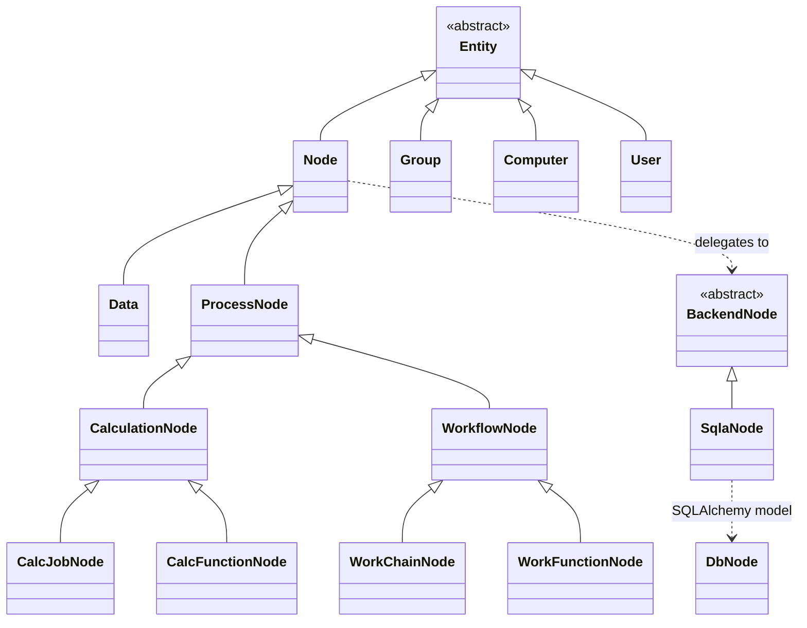
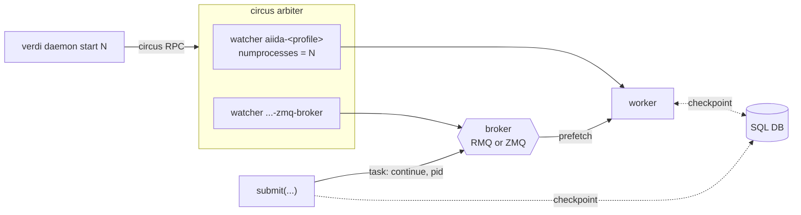
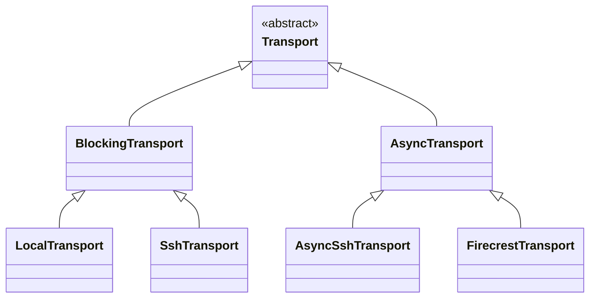
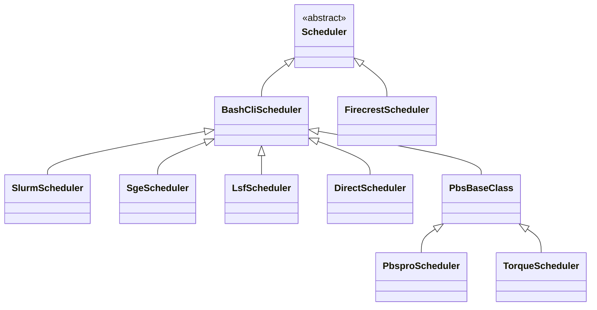

<div class="flex items-center gap-10" style="height: 100%">
<div class="title-hero" style="flex: 1 1 auto">

# AiiDA behind the curtain

**Julian Geiger** · PSI

MaterialsCommons WP4 · 7 September 2026

</div>
<div class="flex flex-col items-center gap-10" style="flex: 0 0 310px">
  <div class="flex items-center gap-5">
    
    
  </div>
  
</div>
</div>

<!--
Q:
-->

---

# Plenty of workflow managers

<div class="grid grid-cols-2 gap-16 pt-10 text-center">
<div>
  <div class="text-base font-mono">pditommaso/awesome-pipeline</div>
  <div class="text-lg opacity-40 pt-1">&darr;</div>
  <div class="text-3xl pt-1">237</div>
</div>
<div>
  <div class="text-base font-mono">meirwah/awesome-workflow-engines</div>
  <div class="text-lg opacity-40 pt-1">&darr;</div>
  <div class="text-3xl pt-1">115</div>
</div>
</div>

<div class="text-center pt-14 italic opacity-80">

The difference lies in their foundations and architecture.

</div>

<div class="refs">
<a href="https://github.com/pditommaso/awesome-pipeline">github.com/pditommaso/awesome-pipeline</a><br>
<a href="https://github.com/meirwah/awesome-workflow-engines">github.com/meirwah/awesome-workflow-engines</a>
</div>

<!--
Q:
-->

---
layout: section
---

# Foundations

<!--
Q:
-->

---

# High-throughput

<div class="flex justify-center pt-2">
  
</div>

<div class="text-sm pt-2 text-center">

2033 Grace Hopper nodes, <b>8132 GPUs and 585,504 CPU cores</b>, 99.96 % utilisation for 18 h

</div>

<div class="text-sm pt-3 text-center">

Throughput scales with the number of daemon workers, independent Python processes, up to about one per CPU core

</div>

<div class="refs center">
Quantum ESPRESSO with SIRIUS · Bercx, Minotakis, Reents · 17 to 18 July 2024 ·
<a href="https://marvel-nccr.ch/highlights/AiiDA-hero-run-Alps">marvel-nccr.ch/highlights/AiiDA-hero-run-Alps</a>
</div>

<!--
Q:
-->

---

# Provenance

<div class="grid grid-cols-5 gap-4">
<div class="col-span-3 flex justify-center">
  
</div>
<div class="col-span-2 text-sm pt-6">

- Recorded as the workflow runs: `while_`, `if_`, dynamic submission
- Immutable once stored, links validated, processes sealed
- Results traceable at any future point in time

</div>
</div>

<!--
Cut from the slide, worth saying aloud:
- Calculations create data, workflows return existing data
- Acyclic data provenance, so well-defined ancestor queries

-->

---
layout: section
---

# Architecture

<!--
Q:
-->

---

# Source layout

<div class="grid grid-cols-2 gap-6 pt-2">
<div>

<pre class="text-sm" style="line-height: 1.35">src/aiida/
├─ <b>brokers/</b>
├─ calculations/
├─ <b>cmdline/</b>
├─ common/
├─ <b>engine/</b>
├─ manage/
├─ <b>orm/</b>
├─ parsers/
├─ plugins/
├─ <b>repository/</b>
├─ restapi/
├─ <b>schedulers/</b>
├─ sphinxext/
├─ <b>storage/</b>
├─ tools/
├─ <b>transports/</b>
└─ workflows/</pre>

</div>
<div class="flex flex-col justify-center gap-4 text-sm opacity-70">

→ &nbsp;**bold**: the rest of this section

</div>
</div>

<!--
Q:
-->

---

# Storage

<div class="text-sm pt-1">

- PostgreSQL / SQLite: the graph, plus each node's `attributes` and `extras` as JSONB
- the file repository, `disk-objectstore`:
  - content-addressed by SHA-256, deduplicated
  - raw files, never queried by content
- Only file-content hash crossing between both

</div>

<div class="grid grid-cols-2 gap-6 pt-2 compact">
<div class="text-xs">

`repository_metadata`, a column on the `Node`

```json
{"o": {"aiida.in": {"k": "0fc524ff…bfeb1"},
       ".aiida": {"o": {
          "calcinfo.json": {"k": "58d7e318…f782a"}}}}}
```

`o` for `objects`, recursive; `k` for `key`, the SHA-256

</div>
<div class="text-xs">

the container, `$AIIDA_PATH/.aiida/repository/<profile>/container/`

```text
loose/aa/bbcc…   one file per object
packs/0,1,2      append-only, 4 GiB target
packs.idx        SQLite: hash → pack, offset
```

one `loose` file per new object, packed by `verdi storage maintain`


</div>
</div>

<div class="refs">
<a href="https://github.com/aiidateam/disk-objectstore">github.com/aiidateam/disk-objectstore</a>
</div>

<!--
Q: why does SqliteDosStorage inherit from PsqlDosBackend?

A: Reuse, not is-a. Sqlite overrides __init__, get_container,
initialise_database, _alembic_config, validate_storage, migrate, the paths and
initialise; when the child overrides most of the parent it should be a sibling
under a shared SQLAlchemy base instead.
Recognised: aiida-core#7510, "v3: Storage architecture redesign", open.
Concrete case for the "less inheritance, more composition" bullet later.
-->

---

# The ORM, object-relational mapping

<div class="grid grid-cols-9 gap-2 pt-2">
<div class="col-span-6">



</div>
<div class="col-span-3 text-sm pt-4">

- Interact with DB objects as Python classes
- `Entity`: pk, uuid, `store()`
- `Node`: links, attributes, extras, file repository
- `Data` subclasses: primitives, files, folders, structures, arrays

</div>
</div>

<!--
Q: difference between CalcFunctionNode and CalcJobNode?

A: Both CalculationNode subclasses, so both CREATE data.
CalcJobNode: external executable via a scheduler; stores remote_workdir,
job_id, scheduler_state, retrieve_list.
CalcFunctionNode: @calcfunction in the local interpreter; stores the function
name and source location instead.
Same split one branch over: WorkChainNode vs WorkFunctionNode.

Q: difference between Entity and Node?

A: Entity is the base for everything stored in a profile: pk, uuid, store(),
is_stored, a collection, and a backend entity behind it. Node, Group, Computer,
User, Comment, Log and AuthInfo are all Entities.
Node is the one that sits in the provenance graph, so it adds what the others
have no use for: links, attributes and extras, a file repository, caching. All
reached through node.base (base.links, base.attributes, base.repository).

Q: responsibilities of BackendNode, SqlaNode, and DbNode, each?

A: BackendNode: the storage-agnostic contract, 28 abstract members, no SQL.
SqlaNode: the SQLAlchemy implementation of it. Wraps one DbNode, holds the
session. Shared by psql_dos and sqlite_dos, since SqliteDosStorage subclasses
PsqlDosBackend.
DbNode: the SQLAlchemy declarative model, table db_dbnode. Columns only.

Naming is historical: Db* and the db_db prefix are Django-era, kept through the
move to SQLAlchemy. Sqla* names the wrapper, not the model.

Q: Three layers: ORM class, storage contract, SQLAlchemy model


-->

---

# Querying the graph

<div class="grid grid-cols-9 gap-2 pt-2">
<div class="col-span-5 text-xs">

```python
qb = QueryBuilder()
qb.append(
    Group,
    filters=Group.fields.label == 'mc3d/structures',
    tag='group',
)
qb.append(
    StructureData,
    with_group='group',
    tag='structure',
    project=[StructureData.fields.uuid],
)
qb.append(
    CalcJobNode,
    with_incoming='structure',
    filters=(
        (CalcJobNode.fields.process_state == 'finished')
        & (CalcJobNode.fields.exit_status == 0)
    ),
    project=['*'],
)

qb.all()
```

</div>
<div class="col-span-4 text-sm pt-2">

- Path through the graph with `append`
- Relationships: `with_group`, `with_incoming`, `with_outgoing`, `with_ancestors`, `with_descendants`
- `Class.fields.*` for filters and projections, typed and autocompleting
- `project`: what each result row carries

</div>
</div>

<!--
Q: Write the query in prose here

A: "Take the group labelled mc3d/structures. For every StructureData in it,
find the CalcJobNodes that consumed it as an input and finished with exit
status 0. Return the structure's UUID alongside the CalcJobNode itself."

Three vertices, two joins: group to structure by membership, structure to
calculation by an input link.

Cut from the slide, worth saying aloud: ancestors and descendants traverse
`CREATE` and `INPUT_CALC` only, the acyclic half of the graph.

-->

---

# Submitting a workflow

```python
from aiida.engine import submit

node = submit(SomeWorkChain, **inputs)  # returns immediately
```

<div class="text-sm pt-4">

- One `ProcessNode` row per process
- `submit()` serialises inputs, context and state into `checkpoints`
- Daemon worker --- background Python process with an event loop --- picks it up
- Process rebuilt from its checkpoint, stepped to the next state
- Every `Process` is a state machine: `CREATED`, `RUNNING`, `WAITING`, `FINISHED`, `EXCEPTED`, `KILLED`
- Checkpoint rewritten at every transition: a killed daemon resumes
- `CalcJob`: the process wrapping one simulation code

</div>

<!--
Q:
-->

---

# The daemon and the broker

<div class="text-sm pt-2 compact">

**Daemon**

- `verdi daemon start N`: N workers, supervised by `circus`
- One worker: one OS process, one asyncio loop
- Each AiiDA process: a coroutine on that loop

**Broker**

- The message layer between `submit()`, the workers, and `verdi`
- RPC: pause, play, kill one running process by its pk
- Broadcast: `state_changed`, subscribed to by waiting workchains
- RabbitMQ and ZeroMQ as available brokers

</div>

<div class="refs">
<i>Add ZeroMQ-based message broker plugin</i> &nbsp;<a href="https://github.com/aiidateam/aiida-core/pull/7284">github.com/aiidateam/aiida-core/pull/7284</a>
</div>

<!--
Q: where are the watchers actually defined?

A: DaemonClient._start_daemon in engine/daemon/client.py builds a `watchers`
list and passes it to circus as arbiter_config['watchers']. A watcher is a
command plus how many copies to keep alive.
Worker watcher, always: cmd `verdi -p <profile> daemon worker`, name
aiida-<profile>, numprocesses = the N from `verdi daemon start N`.
Broker watcher, only if the broker is ZeroMQ and check_service_reachable() finds
nothing already serving: cmd `verdi daemon broker`, numprocesses 1.
That condition is "no services required": with RabbitMQ the broker is someone
else's systemd unit, so no watcher is added.

Script:

There are two separate things on this slide, and the whole point is that they
stay separate. The daemon is who runs your workflows. The broker is how
messages reach them. They use different channels and they fail independently.

Start with the daemon. When you type verdi daemon start with a number, AiiDA
does not itself supervise anything. It starts circus, an external process
supervisor, the same family as supervisord, and hands it a list of programs to
keep running. Circus knows nothing about AiiDA. It starts programs, keeps the
number you asked for alive, and restarts them when they die.

The program it keeps alive is a daemon worker, and a worker is less mysterious
than the name suggests. It is one operating system process running one asyncio
event loop. Every AiiDA process that worker is looking after is a coroutine on
that single loop. This is why a workchain waiting three days for a scheduler
job costs almost nothing: it is a suspended coroutine, so it holds no thread
and no connection.

Then the control commands. Verdi daemon status, incr, decr and stop all speak
to circus, and they only ever do process management: how many workers, are they
alive, stop them. The channel is an IPC socket. IPC stands for inter-process
communication, and the socket is a Unix domain socket, which is a file on disk
rather than a network port. That file lives in a temporary directory, with a
per-profile pointer to it under the AiiDA config directory, at
daemon/circus-<profile>.sockets. Being a file rather than a port is why this
only works from the same machine. The commands are sent as RPC, remote
procedure call, which just means you send a request naming an operation and its
arguments and get an answer back. Remote here means another process, not
another machine.

Now the broker, which is the second half. Submit does not touch circus at all.
When you call submit, the process is written to the database, and a message is
put on the broker. That message is smaller than people expect: a task named
continue carrying a process id, and that id is the primary key of the
ProcessNode, the same number verdi process list prints. It is not an operating
system process id. So the message carries no state whatsoever. The worker that
picks it up loads that node, reads the checkpoint out of its attributes,
deserialises it back into a live process object, and continues stepping it.
Everything it needs was already in the database before the message was sent.

The broker carries three kinds of traffic, and they behave differently. The
task queue is the durable one: work that some worker must eventually pick up.
Exactly one worker takes each task, and the acknowledgement is deferred until
the process reaches a terminal state, so if you stop the daemon halfway the
task was never acknowledged, it gets redelivered, and the process resumes from
its last checkpoint. Second, RPC, the same idea as before but addressed to one
specific running process by its primary key. That is what verdi process pause,
play and kill use, which is also why those commands need a running daemon.
Third, broadcasts, which are fan-out notices such as state changed. That is the
mechanism behind a parent workchain waking up when its child finishes.

A fair question here is why a broker is needed at all, when circus manages fine
with a plain socket. The answer is that a socket is only a transport. In fact
AiiDA's own ZeroMQ broker binds an IPC socket too, so the transport is the same
family. What the broker adds is queue semantics: messages that survive a
restart, a sender and a receiver that need not be alive at the same time,
distribution across several workers each with a prefetch limit, and fan-out to
many listeners. A bare socket drops the message when nobody is listening.

Finally, both of those sit behind one Communicator interface, which is why
RabbitMQ and ZeroMQ are interchangeable. The engine genuinely cannot tell which
one it is running on. ZeroMQ is a socket library rather than a broker, so for
that option AiiDA implements the broker itself, including a persistent
folder-based queue. RabbitMQ remains the choice when the workers live on
another host, because an IPC socket is same-machine only.

-->

---
hide: true
---

# The daemon and the broker



<div class="text-sm pt-1">

- Solid: control. Dashed: state.
- Checkpoint: read back, rewritten at every transition

</div>

<!--
Q:
-->

---

# `verdi`, the command line

<div class="text-xs pt-2">

```text
$ verdi status
 ✔ version:     AiiDA v2.10.0.dev0
 ✔ config:      /home/geiger_j/aiida_projects/aiida-dev/.aiida
 ✔ profile:     tutorial
 ✔ storage:     SqliteDosStorage[/home/geiger_j/aiida_projects/aiida-dev/.aiida/repository/sqlite_dos_f4ff…]: open,
 ✔ daemon:      Daemon is running with PID 830741, Broker PID 830744 [0 pending, 0 processing]
```

</div>

<div class="text-xs pt-3">

```text
$ verdi process list -a
  PK  Created    Process label             ♻    Process State    Process status
----  ---------  ------------------------  ---  ---------------  ----------------
   5  5s ago     MultiplyAddWorkChain           ⏹ Finished [0]
   6  5s ago     multiply                       ⏹ Finished [0]
   8  5s ago     ArithmeticAddCalculation       ⏹ Finished [0]

Total results: 3

Report: ♻ Processes marked with check-mark were not run but taken from the cache.
Report: Last time an entry changed state: 4s ago (at 15:41:34 on 2026-09-06)
Report: Using 0% of the available daemon worker slots.
```

</div>

<!--
Q:
-->

---

# Transport and scheduler

<div class="grid grid-cols-2 gap-4 pt-1">
<div>



</div>
<div>



</div>
</div>

<div class="text-sm pt-1 compact">

- `Transport` and `Scheduler`: file transfer and remote commands, job submission
- `aiida-firecrest`: transport and scheduler for the FirecREST API, from CSCS
- `TransportQueue`: one shared transport per computer and user
- One `squeue` per computer per polling interval
- Exponential backoff on transport tasks, ending in a paused state

</div>

<div class="refs">
<i>Transport: AsyncTransport plugin</i> &nbsp;<a href="https://github.com/aiidateam/aiida-core/pull/6626">github.com/aiidateam/aiida-core/pull/6626</a>
</div>

<!--
Q:
-->

---
layout: section
---

<div class="flex items-center justify-between gap-10" style="height: 100%">
<div style="white-space: nowrap">

# Making it simpler

</div>
<div class="flex-none">
  
</div>
</div>

<!--
Q:
-->

---

# No services required

<div class="text-sm pt-2">

```bash
pip install aiida-core
verdi presto
```

</div>

<div class="text-sm pt-4">

- PostgreSQL the only database until v2.5, now also SQLite (a file, no server)
- RabbitMQ the only broker until v2.9, now also ZeroMQ
- ZeroMQ Broker started and supervised by the daemon (RMQ runs as OS background process)
- IPC sockets, local only; workers on another host (currently) still need RabbitMQ

</div>

<div class="refs">
<i>Released in v2.5.0 · Add the <code>SqliteDosStorage</code> storage backend</i> &nbsp;<a href="https://github.com/aiidateam/aiida-core/pull/6148">github.com/aiidateam/aiida-core/pull/6148</a><br>
<i>Released in v2.9.0 · Add ZeroMQ-based message broker plugin</i> &nbsp;<a href="https://github.com/aiidateam/aiida-core/pull/7284">github.com/aiidateam/aiida-core/pull/7284</a>
</div>

<!--
Q:
-->

---

# Profile creation

<div class="text-sm pt-1 pb-2">

- An AiiDA profile: one database, one file repository, one broker

</div>

<div class="grid grid-cols-12 gap-4">
<div class="col-span-3 text-xs">

```bash
# install PostgreSQL
# and RabbitMQ, create
# the database and its
# user, then describe it
verdi setup \
    --database-engine \
    --database-backend \
    --database-hostname \
    --database-port \
    --database-name \
    --database-username \
    --database-password \
    --broker-protocol \
    --broker-username \
    --broker-password \
    --broker-host \
    --broker-port \
    --broker-virtual-host \
    --repository-uri
```

</div>
<div class="col-span-9 text-xs">

```text
$ verdi presto --use-zeromq
Report: Option `--use-postgres` not enabled: configuring the profile to use SQLite.
Report: `--use-zeromq` enabled: configuring the profile with ZeroMQ broker.
Report: Initialising the storage backend.
Report: Migrating to the head of the main branch
Report: Storage initialisation completed.
Success: Created new profile `presto`.
Success: Configured the localhost as a computer.
```

<div class="text-sm pt-3 compact">

- `verdi quicksetup` created the database, still needed both services
- `verdi presto`: no required options since v2.6, no services since v2.9
- Full control retained: `verdi profile setup core.psql_dos`
- **progressive disclosure**

</div>

</div>
</div>

<!--
Q:
-->

---
layout: section
---

# Current efforts

<!--
Q:
-->

---

# v3: Consolidation into core

<div class="grid grid-cols-2 gap-6 pt-3 text-sm">
<div>

**What is moving**

- `aiidateam/plumpy`, the process state machine
- The workflow construction ecosystem:
  - `aiida-shell`: cmd execution without plugins
  - `aiida-pythonjob`: execute Python on remote
  - `node-graph`: graph-based workflow API
  - `aiida-workgraph`: exec layer of `node-graph` API
- Minor upstream changes require releases
- Blurred package boundaries, and the coupling that follows
- Easier reasoning on architecture, code deduplication

</div>
<div>

**Directions**

- Less inheritance, more composition
- ORM and storage redesigns
- Still open to extensions via ABCs, Protocols, and entry points

</div>
</div>

<div class="refs">
<i>Redesign ORM with Pydantic-first mindset</i> &nbsp;<a href="https://github.com/aiidateam/aiida-core/issues/7391">github.com/aiidateam/aiida-core/issues/7391</a><br>
<i>v3: Storage architecture redesign</i> &nbsp;<a href="https://github.com/aiidateam/aiida-core/issues/7510">github.com/aiidateam/aiida-core/issues/7510</a>
</div>

<!--
Q:
-->

---

# v3: Workflow construction

<div class="grid grid-cols-2 gap-6 text-xs">
<div>

`WorkChain`

```python
class MultiplyAddWorkChain(WorkChain):
    @classmethod
    def define(cls, spec):
        super().define(spec)
        spec.input('x', valid_type=Int)
        spec.input('y', valid_type=Int)
        spec.input('z', valid_type=Int)
        spec.input('code', valid_type=AbstractCode)
        spec.outline(
            cls.multiply,
            cls.add,
            cls.validate_result,
            cls.result,
        )
        spec.output('result', valid_type=Int)
```

plus four methods passing data through `self.ctx`

</div>
<div>

`WorkGraph` (used for PWD)

```python
@task
def add(x: int, y: int) -> int:
    return x + y


@task
def multiply(x: int, y: int) -> int:
    return x * y


@task.graph
def AddMultiply(x: int, y: int, z: int) -> int:
    the_sum = add(x=x, y=y).result
    return multiply(x=the_sum, y=z).result


wg = AddMultiply.build(x=2, y=3, z=4)
wg.run()
```

</div>
</div>

<!--
Q:
-->

---

# v3: Workflow as an object

<div class="grid grid-cols-2 gap-6 pt-2">
<div class="flex items-center">
  
</div>
<div class="text-sm pt-6">

- `AddMultiply.build(...)`: an object, before submission
- Inspectable and editable in Python, then run
- GUI: visualize tasks, sockets, links
- `WorkChain`: nothing to inspect before it runs

</div>
</div>

<!--
Q:
-->

---

# v3: User and core API

<div class="text-sm pt-3">

- Most symbols re-exported upwards: `orm.StructureData`
- Deep paths still reachable: `aiida.orm.nodes.data.structure`
- Convention: below the second level private, unenforced
- v3: small `core` and `user` modules, importing and re-exporting explicitly
- Everything outside them internal, free to change
- Per-module migration files, to upgrade plugins automatically

</div>

<div class="refs">
<i>AEP v3: clear public and private API</i> &nbsp;<a href="https://github.com/aiidateam/aiida-core/issues/7410">github.com/aiidateam/aiida-core/issues/7410</a><br>
<i>v3: user/core API revision</i> &nbsp;<a href="https://github.com/aiidateam/aiida-core/pull/7562">github.com/aiidateam/aiida-core/pull/7562</a>
</div>

<!--
Q:
-->

---

# Agents

<div class="grid grid-cols-9 gap-3 pt-2">
<div class="col-span-5 text-sm">

**`aiida-agents`**, GSoC 2026

```text
src/aiida_agents/
├─ agents/    analysis · codegen · execution · planner
├─ mcp/       MCP server, read-only tools
├─ rag/       chunking, embedding, retrieval, citations
├─ sandbox/   profile copy, code runner, static guard
└─ tools/     typed tool functions
```

- Explore, inspect, diagnose, look up the docs, set up, run
- Typed tool calls against your own provenance graph
- Writes behind an explicit approval gate
- Provider agnostic, supporting local models 

</div>
<div class="col-span-4 text-sm">

**How we develop**

- `AI_POLICY.md`: a responsible human author per PR
- `AGENTS.md` and 10 Claude Code skills in-repo
- CodeRabbit reviews on every non-draft PR
- Large-scale architectural changes within reach through the help of agents

</div>
</div>

<div class="refs">
<i>Add AI_POLICY.md</i> &nbsp;<a href="https://github.com/aiidateam/aiida-core/pull/7229">github.com/aiidateam/aiida-core/pull/7229</a><br>
<i>Add AGENTS.md and Claude Code skills</i> &nbsp;<a href="https://github.com/aiidateam/aiida-core/pull/7265">github.com/aiidateam/aiida-core/pull/7265</a><br>
<i>Add explicit CodeRabbit configuration</i> &nbsp;<a href="https://github.com/aiidateam/aiida-core/pull/7471">github.com/aiidateam/aiida-core/pull/7471</a>
</div>

<!--
Q:
-->

---
layout: section
---

# Ecosystem

<!--
Q:
-->

---

# Plugins and common workflows

<div class="grid grid-cols-2 gap-6 pt-2">

<div class="flex flex-col">
  <div class="flex items-center justify-center" style="height: 300px">
    
  </div>
  <div class="text-sm pt-2">108 plugin packages, 72 wrapping a simulation code</div>
</div>

<div class="flex flex-col">
  <div class="flex items-center justify-center" style="height: 300px">
    
  </div>
  <div class="text-sm pt-2"><code>aiida-common-workflows</code>: code-agnostic interface for 13 engines</div>
</div>

</div>

<div class="refs">
<a href="https://aiida.net/plugin-registry/">aiida.net/plugin-registry</a> &nbsp;·&nbsp;
<a href="https://github.com/aiidateam/aiida-common-workflows">github.com/aiidateam/aiida-common-workflows</a>
</div>

<!--
Q:
-->

---

# Publishing and browsing

<div class="grid grid-cols-2 gap-6 pt-2">

<div class="flex flex-col">
  <div class="flex items-center justify-center" style="height: 320px">
    
  </div>
  <div class="text-sm pt-2">Materials Cloud Archive: 1238 records, each with a DOI</div>
</div>

<div class="flex flex-col">
  <div class="flex items-center justify-center" style="height: 320px">
    
  </div>
  <div class="text-sm pt-2">Published provenance, browsable node by node</div>
</div>

</div>

<div class="refs">
<a href="https://archive.materialscloud.org">archive.materialscloud.org</a> &nbsp;·&nbsp;
<a href="https://www.materialscloud.org/explore">materialscloud.org/explore</a>
</div>

<!--
Q:
-->

---

# AiiDAlab

<div class="flex justify-center pt-1">
  
</div>

<div class="grid grid-cols-2 gap-8 pt-3 text-sm">
<div>

- Jupyter-based, with an app store; 16 apps registered
- Each panel above a plugin, with its own workchains

</div>
<div>

- Public demo, institutional JupyterHubs, or local Docker
- `aiida-core` as the engine underneath

</div>
</div>

<div class="refs">
<a href="https://www.aiidalab.net">aiidalab.net</a> &nbsp;·&nbsp;
<a href="https://demo.aiidalab.io">demo.aiidalab.io</a>
</div>

<!--
Q:
-->

---
class: text-center
---

<div class="flex flex-col justify-center" style="height: 100%">

# Thanks!

<div class="pt-1 text-lg opacity-60">Questions?</div>

<div class="flex justify-center items-center gap-8 pt-10">
  
  
</div>

</div>

<div class="refs center">
<a href="https://aiida.net">aiida.net</a> &nbsp;·&nbsp;
<a href="https://aiida.readthedocs.io">aiida.readthedocs.io</a> &nbsp;·&nbsp;
<a href="https://github.com/aiidateam/aiida-core">github.com/aiidateam/aiida-core</a> &nbsp;·&nbsp;
<i>v3 board</i> <a href="https://github.com/orgs/aiidateam/projects/21">github.com/orgs/aiidateam/projects/21</a>
</div>

<!--
Q:
-->

---
src: ./backup.md
hide: true
---
